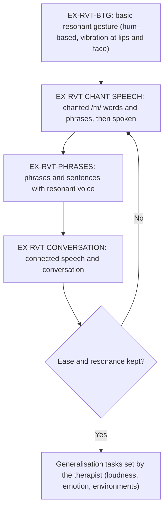

# Resonant Voice Therapy (RVT) and Lessac-Madsen Resonant Voice Therapy (LMRVT)

## 1. Purpose and scope

This file covers resonant voice therapy in its main forms: Lessac-Madsen Resonant Voice Therapy (LMRVT), Y-Buzz, "resonance therapy" and humming-based programs [1]. It defines four exercise IDs that follow the usual hierarchy from a basic resonant gesture to conversation, and maps the seeds `ex-humming` and `ex-chant-speech`. The LMRVT clinician and patient manuals (Verdolini Abbott, Plural Publishing) are licensed and are not reproduced; the hierarchy is described only at the level reported in peer-reviewed papers. Humming as a stand-alone SOVT task is [EX-SOVT-HUM](sovt.md#ex-sovt-hum).

## 2. Summary table

| ID | Step | Task (paraphrased) | Verification type | Seed id | Home suitability |
|---|---|---|---|---|---|
| EX-RVT-BTG | Basic resonant gesture | Easy hum-based voicing with vibration felt at the lips and front of the face | sustained | `ex-humming` | With training |
| EX-RVT-CHANT-SPEECH | Chant to speech | Chant /m/-initial words or phrases on one note, then speak them with the same ease | checklist | `ex-chant-speech` | With training |
| EX-RVT-PHRASES | Phrases and sentences | Resonant production carried into phrases and sentences | checklist | none | With training |
| EX-RVT-CONVERSATION | Conversation | Resonant voice in connected speech and conversation | checklist | none | With training |

Evidence: **Moderate**. One systematic review (9 studies, 2 RCTs) rated overall quality moderate but called the evidence limited [1]; RCTs in teachers [2], in mixed voice disorders [3] and a network meta-analysis in which resonant voice significantly reduced VHI-30 [4]. Typical program: 6-8 weekly clinic sessions plus home practice twice daily [3][2].

## 3. Body

### 3.1 Mechanism

Resonant voice is produced with the vocal folds barely touching or barely separated; in 12 performers with and without nodules, resonant voice used this configuration, distinct from pressed and breathy voice [5]. The rationale is that this posture gives a strong, easy voice with low vocal fold impact. In a small double-blind study of nine healthy adults after vocal loading, resonant voice exercises gave the best profile of inflammatory markers at 24 hours compared with spontaneous speech or voice rest [6]. **Limited.** Resonant voice also relies on a semi-occluded start (/m/, voiced consonants) [3], linking it to [SOVT](sovt.md).

Teaching is sensation-based: patients attend to vibration in the front of the face and to ease, and generalise this from a basic gesture to speech [1][3].

### 3.2 Van Stan 2015 taxonomy classification

Van Stan and colleagues classified RVT as a direct intervention with auditory (hearing one's own voice), somatosensory (vibration sensations), vocal function (easy voicing, /m/ phonation, pitch variation), musculoskeletal (stretching, head and neck alignment) and respiratory components [7].

### 3.3 Hierarchy



The movement from semi-occluded exploration into connected speech and conversation is as reported for LMRVT in a 2024 RCT [3]; the intermediate steps follow the published descriptions of humming, chant and phrase work in RVT studies [1]. Exact manual wording is not reproduced.

### 3.4 Indications

| Indication | Link | Evidence |
|---|---|---|
| Vocal fold nodules and phonotrauma | [DX-NODULES](../02-disorders/vocal-fold-nodules.md#dx-nodules) | 26 women with nodules, 8 weeks, 14 total and 9 partial regressions, uncontrolled [8]; children with nodules, small RCT [9]; early comparison with confidential voice [10] |
| Teachers | [DX-OCC-TEACHER](../02-disorders/occupational-voice-users.md#dx-occ-teacher) | RCT, 64 teachers [2]; 24 Taiwanese teachers [11]; 34 Chinese teachers [12]; student teachers [13] |
| Functional dysphonia, MTD | [DX-MTD-PRIMARY](../02-disorders/muscle-tension-dysphonia.md#dx-mtd-primary) | 34 women, controlled [14]; mixed disorders RCT [3] |
| Singers and actors | [DX-OCC-SINGER](../02-disorders/occupational-voice-users.md#dx-occ-singer) | Indian Carnatic singers, 6 participants [15]; Y-Buzz in actors [16] |

Laryngoscopy and diagnosis come first [17].

### 3.5 Contraindications and cautions

- No adverse events were reported in the reviewed studies; harms were not systematically collected. **Not established.**
- Resonant voice depends on correct sensation; a patient who "places" the voice by pushing loudness or pressing may practise the wrong pattern. Teaching is clinician-led [3].
- Spasmodic dysphonia and neurological voice disorders are outside the evidence base ([DX-SD](../02-disorders/spasmodic-dysphonia.md#dx-sd)).
- Adherence is a known weakness: LMRVT patients in one RCT practised zero to once a day on average versus the prescribed twice, and clinicians judged tube practice easier [3].

### 3.6 Dosage

| Study | Population | Clinic sessions | Home practice | Duration | Outcome |
|---|---|---|---|---|---|
| Heller-Stark 2024 [3] | 67 mixed voice disorders | 4 or 8 weekly, 55-60 min | Twice daily per manual (actual 0-1 per day) | 4 or 8 weeks | 8-week LMRVT VHI -15.74 vs control (95% CI -29.40 to -2.08); 4 vs 8 weeks not different |
| Roy 2003 [2] | 64 teachers | Not stated in abstract | Prescribed | 6 weeks | VHI reduced with resonance therapy |
| Chen 2007 [11] | 24 female teachers | Group, 90 min, weekly | Not stated in abstract | 8 weeks | Perceptual, stroboscopic and VHI-physical gains |
| Saltürk 2019 [8] | 26 women with nodules | Not stated in abstract | Not stated | 8 weeks | VHI-10 22.25 to 8.92 |
| Hacıoğlu 2025 [14] | 34 women, functional | Not stated in abstract | Not stated | 8 weeks | VHI-10 20.88 to 9.06 |
| Ma 2024 [9] | 17 children with nodules | 6 weekly, 1 h | Not stated | 6 weeks | Perceptual and pVHI gains |
| Liu 2022 [12] | 34 teachers | Not stated in abstract | Not stated | Not stated in abstract | VHI 12.19 to 8.63; MPT 14.34 to 17.21 s |

Worked example (dose). LMRVT as in [3]: 8 weekly sessions of about 1 hour plus home practice twice daily for 8 weeks = 8 clinic hours and up to 2 x 7 x 8 = 112 home practice sessions. If the patient practises once a day, as reported on average [3], completion is 56 / 112 = 50%, below the app's default 80% adherence threshold. Home session length is not reported; **Not established**.

Worked example (app assignment). EX-RVT-BTG in week 1 to 2, `sessionsPerDay = 2`, weekdays `{1..7}`; the therapist ends that assignment and assigns EX-RVT-CHANT-SPEECH when the patient can produce the gesture reliably in clinic. No published criterion defines "reliably"; the SLP panel decides.

### 3.7 Home-practice suitability and teaching

RVT requires in-clinic shaping of the sensation before home practice. Home practice is self-guided from the manual's patient materials [3]. An app can support it with audio models of the patient's own good productions recorded in clinic, and reminders; it cannot judge resonance quality from audio with established accuracy.

### 3.8 What the patient records and the acoustic signature

| Exercise | Correct attempt | Incorrect attempt | Measures |
|---|---|---|---|
| EX-RVT-BTG | Continuous nasal murmur, stable F0, moderate relative level | Pressed or loud hum; breathy hum; hum collapsing to an open vowel | [M-PHONATION-TIME](../03-measures/temporal.md#m-phonation-time), [M-F0-SD](../03-measures/f0-pitch.md#m-f0-sd), [M-LEVEL-RELATIVE](../03-measures/intensity.md#m-level-relative) |
| EX-RVT-CHANT-SPEECH, -PHRASES, -CONVERSATION | Speech with stable voicing and no hard onsets | Pressed onsets; loss of voicing; fry at phrase ends | Checklist only; probe measures [M-CPPS-SPEECH](../03-measures/cepstral.md#m-cpps-speech) |

Spectral correlates: in one healthy-voice study, MPT gains after a single LMRVT session correlated with a lower Hammarberg index [18] ([M-HAMMARBERG](../03-measures/spectral.md#m-hammarberg)). This is exploratory; no validated acoustic signature of "resonant" versus "non-resonant" practice exists. **Not established.**

### 3.9 Progress markers

- Self-report: [PROM-VHI10](../06-interpretation/proms.md#prom-vhi10) and effort [PROM-EFFORT](../06-interpretation/proms.md#prom-effort) are the most consistent responders [2][3][8][14].
- Probes: [M-CPPS-SPEECH](../03-measures/cepstral.md#m-cpps-speech), [M-AVQI](../03-measures/composite-indices.md#m-avqi) (used as an outcome in [3]); perturbation measures changed in uncontrolled studies [8][14] but not in children [9].
- Lesion change requires laryngoscopy and is never inferred by the app.

### 3.10 Safety signals that stop practice

[RF-PRACTICE-PAIN](../06-interpretation/red-flags.md#rf-practice-pain), [RF-SUDDEN-VOICE-LOSS](../06-interpretation/red-flags.md#rf-sudden-voice-loss), [RF-PERSISTENT-HOARSENESS](../06-interpretation/red-flags.md#rf-persistent-hoarseness) if voice does not improve as the therapist expects.

### 3.11 Seed mapping

| Seed id | Maps to | Right | Wrong or missing |
|---|---|---|---|
| `ex-humming` | EX-RVT-BTG | Gentle hum, attention to buzz at lips and nose, relaxed jaw, opening to a vowel | 5 s target and 10 x 1 dose are unsourced (LMRVT home practice is twice daily [3]); "chew while humming" is not described in the sources reviewed; program label correct |
| `ex-chant-speech` | EX-RVT-CHANT-SPEECH | Chant on one note, then add melody, then speak with the same ease | 10 x 1 dose unsourced; example phrase should be checked against licensed LMRVT materials and replaced by app-written phrases if it comes from them; checklist verification is appropriate |
| Both | | | `evidenceSource` should cite Yiu2017, HellerStark2024, Roy2003 |

### 3.12 What the app may conclude

- That the patient practised (self-report) and, for EX-RVT-BTG, that a voiced hum of a given length and F0 stability was recorded.

### 3.13 What the app must not conclude

- That the voice was "resonant" or that the technique was correct.
- That nodules or other lesions are shrinking.
- That the patient is ready to move up the hierarchy; the therapist decides.

## 4. Conflicting evidence

- **RVT versus confidential voice.** In 13 women with nodules, benefit tracked compliance, not therapy type [10].
- **RVT versus tubes.** Flow-resistant tube therapy was non-inferior to LMRVT on VHI at a 10-point margin but not at a 5-point margin [3].
- **Program length.** 4 and 8 weeks did not differ on VHI [3], while most uncontrolled studies used 8 weeks [8][11][14].
- **Acoustic outcomes.** Perturbation improved in adult uncontrolled studies [8][14] but not in a small paediatric RCT where untreated controls also improved perceptually [9].

## 5. Gaps and open questions

- Home-practice dose (minutes, repetitions) for each hierarchy step: **Not established**. Study: randomised comparison of prescribed home doses with logged practice and VHI-10 at 8 weeks.
- Acoustic definition of resonant voice for automatic verification: **Not established**. Study: SLP-labelled resonant and non-resonant productions with candidate spectral measures (Hammarberg, alpha ratio, CPPS) and kappa against SLP labels.
- Indian data: one 6-person study in Carnatic singers [15]; no Hindi or Punjabi chant or phrase lists exist. App-written phrase lists in each language need SLP panel review (/m/-initial words are language-specific).

## 6. Implementation in Melo

- Layer: `lib/features/exercises/domain/`; seeds in `lib/features/demo_data/data/demo_program.dart`.
- Existing: `VerificationType.sustained` (EX-RVT-BTG) and `.checklist` (others); hierarchy progression is handled by the therapist ending one `Schedule` and assigning the next.
- Proposed field to show hierarchy order in the library UI:

```dart
// Exercise
final String? hierarchyGroup; // e.g. 'rvt'
final int? hierarchyStep;     // 1 = BTG ... 4 = conversation
```

- Per-language phrase lists belong in localization (`lib/l10n/`), not in the model.
- Data file: [../data/exercises.yaml](../data/exercises.yaml).

<a id="ex-rvt-btg"></a>
### EX-RVT-BTG: Basic resonant gesture

Easy hum-based voicing with attention to vibration at the lips and front of the face; foundation of LMRVT and humming-based RVT [1][3].

<a id="ex-rvt-chant-speech"></a>
### EX-RVT-CHANT-SPEECH: Chant to speech

Chanted /m/-initial words or phrases on one note, then spoken with the same ease [1][3].

<a id="ex-rvt-phrases"></a>
### EX-RVT-PHRASES: Phrases and sentences

Resonant voice carried into phrases and sentences of increasing length [3].

<a id="ex-rvt-conversation"></a>
### EX-RVT-CONVERSATION: Conversation

Resonant voice in connected speech and conversation [3].

## 7. References

1. [Yiu2017] Yiu EM, Lo MC, Barrett EA. 2017. A systematic review of resonant voice therapy. Int J Speech Lang Pathol 19(1):17-29. doi:10.1080/17549507.2016.1226953
2. [Roy2003] Roy N, Weinrich B, Gray SD, et al. 2003. Three treatments for teachers with voice disorders: a randomized clinical trial. J Speech Lang Hear Res 46(3):670-688. doi:10.1044/1092-4388(2003/053)
3. [HellerStark2024] Heller-Stark A, Maxfield L, Herrick J, et al. 2024. Comparative study of two semi-occluded vocal tract protocols: A randomized clinical trial. J Speech Lang Hear Res 67(11):4275-4287. doi:10.1044/2024_JSLHR-22-00456
4. [BarstiesVLatoszek2020] Barsties v. Latoszek B, Watts CR, Neumann K. 2020. The effectiveness of voice therapy on voice-related handicap: A network meta-analysis. Clin Otolaryngol 45(5):796-804. doi:10.1111/coa.13596
5. [Verdolini1998] Verdolini K, Druker DG, Palmer PM, et al. 1998. Laryngeal adduction in resonant voice. J Voice 12(3):315-327. doi:10.1016/s0892-1997(98)80021-0
6. [VerdoliniAbbott2012] Verdolini Abbott K, Li NY, Branski RC, et al. 2012. Vocal exercise may attenuate acute vocal fold inflammation. J Voice 26(6):814.e1-814.e13. doi:10.1016/j.jvoice.2012.03.008
7. [VanStan2015] Van Stan JH, Roy N, Awan S, et al. 2015. A taxonomy of voice therapy. Am J Speech Lang Pathol 24(2):101-125. doi:10.1044/2015_AJSLP-14-0030
8. [Salturk2019] Saltürk Z, Özdemir E, Sari H, et al. 2019. Assessment of resonant voice therapy in the treatment of vocal fold nodules. J Voice 33(5):810.e1-810.e4. doi:10.1016/j.jvoice.2018.04.012
9. [Ma2024] Ma EP, Cheung YC, Siu AK, et al. 2024. The effectiveness of vocal hygiene education with resonant voice therapy for school-aged children with vocal nodules. J Voice 38(2):538.e23-538.e30. doi:10.1016/j.jvoice.2021.08.015
10. [VerdoliniMarston1995] Verdolini-Marston K, Burke MK, Lessac A, et al. 1995. Preliminary study of two methods of treatment for laryngeal nodules. J Voice 9(1):74-85. doi:10.1016/s0892-1997(05)80225-5
11. [Chen2007] Chen SH, Hsiao TY, Hsiao LC, et al. 2007. Outcome of resonant voice therapy for female teachers with voice disorders: perceptual, physiological, acoustic, aerodynamic, and functional measurements. J Voice 21(4):415-425. doi:10.1016/j.jvoice.2006.02.001
12. [Liu2022] Liu H, Chen S, Gao L, et al. 2022. Comparison between combination of resonant voice therapy and vocal hygiene education and vocal hygiene education only for female elementary school teachers. J Voice 36(6):814-822. doi:10.1016/j.jvoice.2020.09.028
13. [Nanjundeswaran2012] Nanjundeswaran C, Li NY, Chan KM, et al. 2012. Preliminary data on prevention and treatment of voice problems in student teachers. J Voice 26(6):816.e1-816.e12. doi:10.1016/j.jvoice.2012.04.008
14. [Hacioglu2025] Hacıoğlu HN, Bengisu S. 2025. Evaluation of the effectiveness of resonant voice therapy in patients with functional voice disorder. J Voice 39(6):1544-1551. doi:10.1016/j.jvoice.2023.07.003
15. [Raveendran2025] Raveendran R, Yeshoda K. 2025. Effects of resonant voice therapy on perceptual and acoustic source and tract parameters: a preliminary study on Indian Carnatic classical singers. J Voice 39(2):560.e1-560.e9. doi:10.1016/j.jvoice.2022.09.023
16. [BarrichelloLindstrom2009] Barrichelo-Lindström V, Behlau M. 2009. Resonant voice in acting students: perceptual and acoustic correlates of the trained Y-Buzz by Lessac. J Voice 23(5):603-609. doi:10.1016/j.jvoice.2007.12.001
17. [AAOHNS2018] Stachler RJ, Francis DO, Schwartz SR, et al. 2018. Clinical practice guideline: Hoarseness (dysphonia) (update). Otolaryngol Head Neck Surg 158(1_suppl):S1-S42. doi:10.1177/0194599817751030
18. [Ochi2026] Ochi K, Kobayashi M, Nakamura T, et al. 2026. Short-term effects of Lessac-Madsen resonant voice therapy on maximum phonation time and its association with acoustic features in young healthy Japanese women. J Voice (online ahead of print). doi:10.1016/j.jvoice.2026.07.062

## 8. Last searched

2026-10-09. PubMed (NCBI E-utilities), PubMed Central full text (Heller-Stark 2024).
