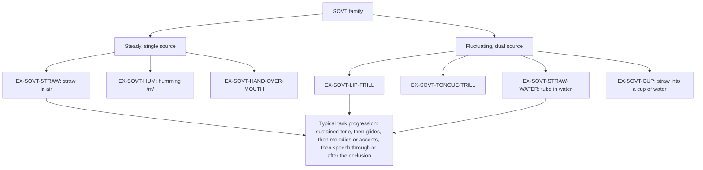

# Semi-Occluded Vocal Tract Exercises (SOVT)

## 1. Purpose and scope

This file defines the seven semi-occluded vocal tract exercises in the Melo library: straw phonation in air, tube or straw phonation in water (water resistance therapy), lip trill, tongue trill, humming, hand-over-mouth and cup phonation. It summarises mechanism, evidence, dosage, safety and home use, and maps the seed exercises `ex-straw` and `ex-lip-trills`. SOVT postures also appear inside other programs: [Vocal Function Exercises](vocal-function-exercises.md) use a lip-rounded /o/, and [resonant voice therapy](resonant-voice-therapy.md) starts from humming. Verification algorithms and pass criteria are owned by [05-exercise-data](../05-exercise-data/README.md).

## 2. Summary table

| ID | Exercise | Source type (Andrade 2014) | Strongest evidence | Home suitability | Verification type | Seed id |
|---|---|---|---|---|---|---|
| EX-SOVT-STRAW | Straw or narrow tube phonation in air | Steady, single source [1] | RCTs [2][3][4]; SR of free-end tubes [5] | Yes, after demonstration | sustained or glide | `ex-straw` |
| EX-SOVT-STRAW-WATER | Tube phonation in water (water resistance therapy) | Fluctuating (bubbles) [6][7] | RCT [3]; meta-analysis of pre-post studies [8] | With training (depth control) | sustained | none |
| EX-SOVT-LIP-TRILL | Voiced lip trill | Fluctuating, dual source [1] | RCTs [3][4]; case series [9] | Yes, after demonstration | sustained or glide | `ex-lip-trills` |
| EX-SOVT-TONGUE-TRILL | Voiced tongue (alveolar) trill | Fluctuating, dual source [1] | Within-subject study [10]; small controlled series [11] | With training (not all patients can trill) | sustained or glide | none |
| EX-SOVT-HUM | Humming on /m/ | Steady, single source [1] | Immediate-effect study [12]; uncontrolled practice studies [13][14] | Yes | sustained | none (see [EX-RVT-BTG](resonant-voice-therapy.md#ex-rvt-btg)) |
| EX-SOVT-HAND-OVER-MOUTH | Phonation into a hand cupped over the mouth | Steady, single source [1] | Immediate EGG study only [1] | Yes | sustained | none |
| EX-SOVT-CUP | Straw phonation into a household cup of water | Fluctuating (bubbles) | Immediate remote study only [15] | Yes, with caution | sustained | none |

Program-level evidence: **Limited to Moderate**. Several RCTs show benefit [2][3][4][16], but the only meta-analysis of SOVT in dysphonia rated the evidence very low and found SOVT not significantly superior to comparison treatments [17]. A 2026 network meta-analysis of 30 RCTs in functional dysphonia found tube phonation in air and water resistance therapy among 10 of 24 approaches that significantly reduced dysphonia severity [18].

## 3. Body

### 3.1 Mechanism

A partial occlusion at the front of the vocal tract raises supraglottal and intraglottal pressure, which strengthens source-filter interaction. In computer simulation this lets the voice reach the same output with more economical vocal fold collision [19]. An integrative review of 53 studies reports that SOVT lowers phonation threshold pressure and perceived phonatory effort and changes spectral and aerodynamic measures during and after the exercise [20].

Exercises differ in how the occlusion behaves. In 23 healthy adults, hand-over-mouth, humming and straw phonation acted as steady, single-source occlusions, while lip trill, tongue trill and tube-in-water acted as fluctuating, dual-source occlusions with a larger range of vocal fold contact quotient [1]. In water resistance therapy the static back pressure is set mainly by water depth [6][21], and bubbling adds a pressure oscillation that modulates vocal fold vibration [7]; a scoping review places this oscillation at 15-40 Hz [22]. Higher loads (deeper immersion or higher subglottic pressure) raised contact quotient, made oral pressure less stable and reduced perceived ease in 40 adults with and without functional dysphonia [23].

Tube geometry sets resistance. Tubes of 2.5-3.0 mm diameter and 10-40 cm length give oral pressures of about 10-40 cm H2O, and immersing the end in water adds pressure equal to the immersion depth [21].



The task progression in the last box follows the clinic hierarchy used in the flow-resistant tube RCT (glides, accent patterns, melodies, then reading through the straw) [2].

### 3.2 Van Stan 2015 taxonomy classification

SOVT is a direct intervention. Its main components are vocal function (sustained and gliding phonation), somatosensory (attention to ease and to vibration felt at the lips or face) and auditory (listening for steady, unbroken voicing); water resistance therapy adds a respiratory component through the controlled back pressure [24]. Van Stan did not classify SOVT as a stand-alone program; this mapping applies the taxonomy's category definitions.

### 3.3 Indications

| Indication | Link | Evidence |
|---|---|---|
| Hyperfunctional or behavioural dysphonia, MTD | [DX-MTD-PRIMARY](../02-disorders/muscle-tension-dysphonia.md#dx-mtd-primary) | RCT, SOVT program equivalent to VFE in 18 patients [16]; NMA [18] |
| Organic dysphonia (nodules, polyps, other benign lesions) | [DX-NODULES](../02-disorders/vocal-fold-nodules.md#dx-nodules), [DX-POLYP](../02-disorders/vocal-fold-polyps.md#dx-polyp) | Indian four-arm RCT, 44 patients [4]; polyp series, 10 patients [11]; tongue trill in 27 women with nodules [10] |
| Glottal gap, including sulcus and MTD with gap | [DX-VF-PARESIS](../02-disorders/vocal-fold-paralysis-paresis.md#dx-vf-paresis) | 42 patients, lip trills reduced gap, least in sulcus [9] |
| Mixed dysphonia (LPR with oedema, lesions, paresis) | [DX-LPR](../02-disorders/lpr-dysphonia.md#dx-lpr) | RCT, tube therapy non-inferior to VFE [2] |
| Teachers and other occupational users | [DX-OCC-TEACHER](../02-disorders/occupational-voice-users.md#dx-occ-teacher) | Indian study in 20 postmenopausal teachers, uncontrolled [25] |
| Singers (warm-up) | [DX-OCC-SINGER](../02-disorders/occupational-voice-users.md#dx-occ-singer) | Immediate-effect studies [14][26] |

As for all voice therapy, laryngoscopy and diagnosis precede assignment [27].

### 3.4 Contraindications and cautions

- Higher water depth or blowing harder increases glottal contact and reduces ease [23]; patients with hyperfunction should start shallow. A scoping review suggests straw in air suits hyperfunction and deeper water suits hypofunction [22]. **Limited.**
- Straw phonation into a cup of water was followed by more perceived strain and louder self-perceived voice than straw phonation in air in a remote study of 36 adults [15]. Home water exercises need an explicit "keep it easy" cue.
- Tongue trill beyond about 5 minutes increased perceived strain in women with nodules [10].
- Not every patient can produce a tongue or lip trill; finger support of the cheeks is a common aid (seed wording) but is unsourced.
- Shared or reused straws and tubes are a hygiene issue; each patient needs their own.
- No serious adverse events were found in the reviewed trials; none systematically reported harms. **Not established.**

### 3.5 Protocol steps (paraphrased)

| ID | Steps |
|---|---|
| EX-SOVT-STRAW | Seal the lips around a narrow straw; produce an easy "oo"-like voiced tone through it so all air leaves through the straw [2]; sustain on a comfortable note; then glide up and down; then sing short melodies through the straw [2]; keep the shoulders and neck loose. |
| EX-SOVT-STRAW-WATER | Fill a bottle about two-thirds with water and place the tube end about 2 cm below the surface (the commonest set-up in published studies [28]); phonate an easy rounded vowel into the tube so the water bubbles steadily; hold, then glide; therapist adjusts depth. |
| EX-SOVT-LIP-TRILL | Loosely close the lips; blow so they vibrate, then add voice; sustain on a comfortable note; glide up and down while keeping the trill going [26][9]. |
| EX-SOVT-TONGUE-TRILL | Rest the tongue tip behind the upper teeth; blow to start an alveolar trill; add voice; sustain or glide [10]. |
| EX-SOVT-HUM | Close the lips gently with teeth apart; hum on /m/ on a comfortable pitch; feel vibration on the lips and face; sustain [12]. |
| EX-SOVT-HAND-OVER-MOUTH | Cup a hand loosely over the mouth; phonate an easy vowel into the hand; sustain [1]. |
| EX-SOVT-CUP | Place a straw in a cup of water; phonate easily through it to make gentle bubbles; sustain [15]. |

### 3.6 Dosage

| Source | Exercise | Reps or time | Sessions per day | Program | Grade |
|---|---|---|---|---|---|
| Kapsner-Smith 2015 [2] | Stirring straw 14.1 cm x 0.4 cm, 4 tasks | 1 min per task | 4 (4 min each) | 6 weeks, 6 weekly clinic sessions | Moderate (RCT, n=20) |
| Meerschman 2019 [3] | Lip trill, WRT or straw | Not reported in abstract | Not reported in abstract | 3 weeks | Moderate (RCT, n=35) |
| Narasimhan 2025 [4] | Lip trill, straw or VFE | 30-40 min clinic sessions | Twice weekly clinic plus home practice | 6 sessions | Moderate (RCT, n=44) |
| Antonetti 2023 [16] | SOVT program vs VFE | 35 min clinic sessions | Twice weekly | 4 weeks | Limited (RCT, n=18) |
| Aji 2026 [25] | Humming, trills, straw in air and water | 8 clinic sessions in month 1 | Daily home practice | 3 months | Limited (uncontrolled, n=20) |
| Menezes 2011 [10] | Tongue trill | Best immediate effect at 5 min; more strain at 7 min | Single session | Immediate | Limited |
| Batista 2024 [28] | Tube in water | Commonest: 3 min, 30 s rests | Single session | Immediate | Scoping review |
| Gillespie 2022 [29] | Occluded facemask | 5 min gave larger aerodynamic effects than 2 min | Single session | Immediate | Limited |

A home dose with RCT support is therefore about 4 minutes, four times a day, for 6 weeks [2]. Days per week are not stated in that report; daily practice is assumed in most programs but is **Not established** as a separately tested parameter.

Worked example (dose). Kapsner-Smith tube protocol: 4 tasks x 1 min x 4 sessions = 16 min of straw work a day; over 6 weeks of daily practice that is 16 x 42 = 672 min. In the app, assigning EX-SOVT-STRAW with `sessionsPerDay = 4` and `repetitions = 4` (one per task) reproduces the session count; per-task duration (60 s) needs a time-on-task field the model lacks.

Worked example (water depth). A tube immersed 2 cm adds about 2 cm H2O to the back pressure; at 5 cm it adds about 5 cm H2O [21]. A therapist moving a patient from 2 to 5 cm more than doubles the water component of the load, which in one study raised contact quotient and reduced ease [23].

### 3.7 Home-practice suitability and teaching

Straw, lip trill and humming need only household items or none, and were delivered remotely in one study [15]. Water exercises need depth control and an "easy" cue because they raised strain in some participants [15][23]. All require one in-clinic demonstration so the patient learns the seal, steady airflow and easy voicing; an SLP-recorded audio model of each task is then sufficient for home practice. Tongue trill needs checking that the patient can trill at all.

### 3.8 What the patient records and the acoustic signature

| Exercise | Correct attempt | Incorrect attempt | Measures |
|---|---|---|---|
| EX-SOVT-STRAW | Continuous voicing, lower radiated level than open vowels; smooth F0 on glides | Voiceless blowing; air escaping through the nose or lip corners; breaks on glides | [M-VOICED-FRACTION](../03-measures/temporal.md#m-voiced-fraction), [M-F0-RANGE](../03-measures/f0-pitch.md#m-f0-range), [M-VOICE-BREAKS](../03-measures/temporal.md#m-voice-breaks) |
| EX-SOVT-STRAW-WATER, EX-SOVT-CUP | Voicing with a regular low-frequency bubble modulation [7][22] | Bubbling without voice; chaotic bubbling from excessive flow [6]; pushed, loud tone | [M-VOICED-FRACTION](../03-measures/temporal.md#m-voiced-fraction), [M-LEVEL-RELATIVE](../03-measures/intensity.md#m-level-relative) |
| EX-SOVT-LIP-TRILL, EX-SOVT-TONGUE-TRILL | Voiced trill sustained, with amplitude modulation from the secondary vibrator [1] | Trill stops; voiceless trill; voice without trill | [M-VOICED-FRACTION](../03-measures/temporal.md#m-voiced-fraction), [M-PHONATION-TIME](../03-measures/temporal.md#m-phonation-time) |
| EX-SOVT-HUM | Nasal murmur with energy concentrated in low frequencies, stable F0 | Mouth opens to a vowel; pressed hum | [M-F0-SD](../03-measures/f0-pitch.md#m-f0-sd), [M-PHONATION-TIME](../03-measures/temporal.md#m-phonation-time) |
| EX-SOVT-HAND-OVER-MOUTH | Continuous voicing, muffled | Hand removed; strained loudness | [M-VOICED-FRACTION](../03-measures/temporal.md#m-voiced-fraction) |

The trill modulation rate and the spectral signature of each occlusion on a phone microphone are not established in the sources reviewed; Agent 5 owns their detection.

### 3.9 Progress markers

- Practice: longer continuous trills or tones, wider glides without breaks.
- Probes: [M-CPPS-VOWEL](../03-measures/cepstral.md#m-cpps-vowel), [M-AVQI](../03-measures/composite-indices.md#m-avqi) and [M-DSI](../03-measures/composite-indices.md#m-dsi) improved after SOVT programs in RCTs [3][4]; jitter, shimmer and HNR improved in an uncontrolled Indian series [25].
- Self-report: [PROM-VHI10](../06-interpretation/proms.md#prom-vhi10) and [PROM-VTDS](../06-interpretation/proms.md#prom-vtds); patients' self-ratings did not always match acoustic change [3].

### 3.10 Safety signals that stop practice

[RF-PRACTICE-PAIN](../06-interpretation/red-flags.md#rf-practice-pain) (pain, strain or a worse voice during or after practice), [RF-SUDDEN-VOICE-LOSS](../06-interpretation/red-flags.md#rf-sudden-voice-loss), and light-headedness from prolonged blowing (proposed as a practice-pain variant; see search log).

### 3.11 Seed mapping

| Seed id | Right | Wrong or missing |
|---|---|---|
| `ex-straw` | Lip seal, easy voicing, siren glides, loose neck; matches RCT task types [2] | 10 repetitions x 1 session per day has no source (the RCT used 4 tasks x 1 min, 4 times a day [2]); the 12-semitone target is invented; "hum oo" mixes humming and vowel; straw size not specified |
| `ex-lip-trills` | Loose lips, add voice, hold on a comfortable note | 8 s target and 10 x 1 dose unsourced; cheek support tip unsourced; no glide variant |
| All | Program label SOVT | `evidenceSource` should cite KapsnerSmith2015, Meerschman2019, Pozzali2024 |

### 3.12 What the app may conclude

- That the patient produced continuous voicing for a given time, and the F0 span of a glide.
- That practice time and continuity are trending up or down.

### 3.13 What the app must not conclude

- That a well-produced trill or straw tone means the occlusion is therapeutically correct (the sealing, effort and airflow cannot be fully judged from audio).
- That SOVT is working for this patient; probe change must be interpreted by the therapist.
- That the patient should change water depth or straw size.

## 4. Conflicting evidence

- **Efficacy versus comparators.** The 2024 meta-analysis found SOVT not significantly better than other treatments on most outcomes, with very low certainty [17], whereas individual RCTs report gains over sham or no treatment [3][4] and non-inferiority to VFE [2][16], and a network meta-analysis lists tube-in-air and water resistance therapy among effective approaches [18].
- **Water versus air.** Water resistance therapy gave more comfort and self-rated quality in one RCT [3] but more perceived strain in a remote study [15]; deeper water raises glottal contact [23][7].
- **Which variant is best.** Lip trill gave the largest improvements in the Indian RCT [4]; straw gave the only perceptual gains in the Belgian RCT [3].

## 5. Gaps and open questions

- Home dosage per exercise (minutes, days per week, weeks) is tested in one RCT only [2]. **Not established** for lip trill, tongue trill, humming, hand-over-mouth and cup phonation. Study: randomised dose comparison (for example 1 vs 4 sessions a day) with probe CPPS and VHI-10 at 6 weeks.
- Acoustic signatures of correct versus incorrect SOVT on phone audio: **Not established**. Study: SLP-labelled practice takes, 10-20 per exercise, to train and validate detection.
- "Cup phonation" is not a standard named technique; the SLP panel should decide whether EX-SOVT-CUP stays separate from EX-SOVT-STRAW-WATER.
- Indian data: one RCT [4] and one uncontrolled series [25]; Bhramari pranayama, a humming-based yogic breath, changed CPPS and LTAS in 30 Indian prospective singers [14]. No Hindi or Punjabi SOVT instruction study was found.

## 6. Implementation in Melo

- Layer: `lib/features/exercises/domain/` and seed content in `lib/features/demo_data/data/demo_program.dart`.
- Existing: `VerificationType.sustained` and `.glide`; `ExerciseTargets.durationSec` and `rangeSemitones`.
- Needed: time-on-task dosing and equipment settings.

```dart
// ExerciseTargets
final double? taskSeconds;        // e.g. 60 s per task in the tube protocol
final double? waterDepthCm;       // EX-SOVT-STRAW-WATER and EX-SOVT-CUP
final double? tubeDiameterMm;     // therapist-recorded equipment
```

- Recording: `RecordingKind.practice`, `RecordingTask.sustainedPhonation` or a proposed `proposed_sovtGlide`; voicing and duration on device; trill and bubble modulation detection on device post-take (Agent 5).
- Data file: [../data/exercises.yaml](../data/exercises.yaml).

<a id="ex-sovt-straw"></a>
### EX-SOVT-STRAW: Straw phonation

Voicing through a narrow straw or tube in air; sustained tones, glides, melodies, then reading through the straw [2]. Steady single-source occlusion [1].

<a id="ex-sovt-straw-water"></a>
### EX-SOVT-STRAW-WATER: Straw or tube phonation in water

Water resistance therapy; depth sets back pressure [6][21]; commonest set-up 2 cm depth, 3 min, 30 s rests [28]. Fluctuating occlusion [1][7].

<a id="ex-sovt-lip-trill"></a>
### EX-SOVT-LIP-TRILL: Lip trill

Voiced bilabial trill, sustained or gliding [3][4][9]. Fluctuating dual-source occlusion [1].

<a id="ex-sovt-tongue-trill"></a>
### EX-SOVT-TONGUE-TRILL: Tongue trill

Voiced alveolar trill; about 5 minutes gave the best immediate effect in women with nodules [10].

<a id="ex-sovt-hum"></a>
### EX-SOVT-HUM: Humming

Sustained /m/; reduced EGG perturbation immediately in patients with benign lesions [12].

<a id="ex-sovt-hand-over-mouth"></a>
### EX-SOVT-HAND-OVER-MOUTH: Hand-over-mouth phonation

Phonation into a cupped hand; steady single-source occlusion [1]. Evidence limited to immediate effects in healthy adults.

<a id="ex-sovt-cup"></a>
### EX-SOVT-CUP: Cup phonation

Straw phonation into a household cup of water, the home form of water resistance therapy studied remotely [15]. Evidence limited to immediate effects; perceived strain increased.

## 7. References

1. [Andrade2014] Andrade PA, Wood G, Ratcliffe P, et al. 2014. Electroglottographic study of seven semi-occluded exercises: LaxVox, straw, lip-trill, tongue-trill, humming, hand-over-mouth, and tongue-trill combined with hand-over-mouth. J Voice 28(5):589-595. PMID 24560003
2. [KapsnerSmith2015] Kapsner-Smith MR, Hunter EJ, Kirkham K, et al. 2015. A randomized controlled trial of two semi-occluded vocal tract voice therapy protocols. J Speech Lang Hear Res 58(3):535-549. doi:10.1044/2015_JSLHR-S-13-0231
3. [Meerschman2019] Meerschman I, Van Lierde K, Ketels J, et al. 2019. Effect of three semi-occluded vocal tract therapy programmes on the phonation of patients with dysphonia: lip trill, water-resistance therapy and straw phonation. Int J Lang Commun Disord 54(1):50-61. PMID 30408272
4. [Narasimhan2025] Narasimhan SV, Raju M, Shivaramu N, et al. 2025. The impact of semi-occluded vocal tract exercises on multidimensional measures of voice in dysphonia: A randomized controlled study. J Voice (online ahead of print). doi:10.1016/j.jvoice.2025.05.007
5. [Asadollahpour2025] Asadollahpour F, Baghban K, Hashemnia SS, et al. 2025. Investigating the effect of semi-occluded vocal tract training with a free-end tube on acoustic characteristics and glottal performance in dysphonic adults: A systematic review. J Voice (online ahead of print). PMID 39939185
6. [Wistbacka2018] Wistbacka G, Andrade PA, Simberg S, et al. 2018. Resonance tube phonation in water: the effect of tube diameter and water depth on back pressure and bubble characteristics at different airflows. J Voice 32(1):126.e11-126.e22. PMID 28528785
7. [Granqvist2015] Granqvist S, Simberg S, Hertegård S, et al. 2015. Resonance tube phonation in water: High-speed imaging, electroglottographic and oral pressure observations of vocal fold vibrations, a pilot study. Logoped Phoniatr Vocol 40(3):113-121. PMID 24865620
8. [BarstiesVLatoszek2023b] Barsties v. Latoszek B, Hetjens S. 2023. Efficacy of Novafon local vibration voice therapy and water resistance therapy: a meta-analysis. Laryngorhinootologie 102(9):662-668. doi:10.1055/a-1976-9766
9. [Nam2019] Nam IC, Kim SY, Joo YH, et al. 2019. Effects of voice therapy using the lip trill technique in patients with glottal gap. J Voice 33(6):949.e11-949.e19. PMID 30104127
10. [Menezes2011] Menezes MH, Ubrig-Zancanella MT, Cunha MG, et al. 2011. The relationship between tongue trill performance duration and vocal changes in dysphonic women. J Voice 25(4):e167-e175. PMID 20655703
11. [deVasconcelos2017] de Vasconcelos D, Gomes AO, de Araújo CM. 2017. Treatment for vocal polyps: lips and tongue trill. J Voice 31(2):252.e27-252.e36. doi:10.1016/j.jvoice.2016.07.003
12. [Vlot2017] Vlot C, Ogawa M, Hosokawa K, et al. 2017. Investigation of the immediate effects of humming on vocal fold vibration irregularity using electroglottography and high-speed laryngoscopy in patients with organic voice disorders. J Voice 31(1):48-56. PMID 27178453
13. [Zenari2023] Zenari MS, Cota ADR, Rodrigues DA, et al. 2023. Do professionals who use the voice in a journalistic context benefit from humming as a semi-occluded vocal tract exercise? J Voice 37(4):634.e19-634.e29. doi:10.1016/j.jvoice.2021.03.011
14. [Jayakumar2024] Jayakumar T, Kalyani A, Kashyap Bannuru Nanjundaswamy R, et al. 2024. A preliminary study on the effect of Bhramari pranayama on voice of prospective singers. J Voice 38(6):1523.e1-1523.e8. doi:10.1016/j.jvoice.2022.05.010
15. [Ford2024] Ford DS, Hunter EJ, Deliyski DD. 2024. Immediate effects of semi-occluded vocal tract exercises on acoustic, auditory-perceptual, and self-perceptual measures of voice production. Folia Phoniatr Logop 76(5):467-481. doi:10.1159/000536002
16. [Antonetti2023] Antonetti AEDS, Vitor JDS, Guzmán M, et al. 2023. Efficacy of a semi-occluded vocal tract exercises-therapeutic program in behavioral dysphonia: A randomized and blinded clinical trial. J Voice 37(2):215-225. PMID 33413982
17. [Pozzali2024] Pozzali I, Pizzorni N, Ruggeri A, et al. 2024. Effectiveness of semi-occluded vocal tract exercises (SOVTEs) in patients with dysphonia: A systematic review and meta-analysis. J Voice 38(1):245.e17-245.e35. PMID 34284924
18. [BarstiesVLatoszek2026] Barsties v. Latoszek B, Saeedi S, Aghadoost S, et al. 2026. Treatment efficacy for functional voice disorders with dysphonia: A network meta-analysis. J Voice (online ahead of print). doi:10.1016/j.jvoice.2026.02.014
19. [Titze2006] Titze IR. 2006. Voice training and therapy with a semi-occluded vocal tract: rationale and scientific underpinnings. J Speech Lang Hear Res 49(2):448-459. doi:10.1044/1092-4388(2006/035)
20. [Apfelbach2024] Apfelbach CS, Guzmán M. 2024. Acoustic, aerodynamic, morphometric, and perceptual changes during and after semi-occluded vocal tract exercise: An integrative review. J Voice 38(2):404-425. PMID 34774370
21. [Titze2025] Titze IR, Maxfield L, Cox KT. 2025. Optimizing diameter, length, and water immersion in flow resistant tube vocalization. J Voice 39(2):403-409. doi:10.1016/j.jvoice.2022.09.029
22. [Haddad2026] Haddad R, Ebode D, Mattei A, et al. 2026. Comparing straw-based semi-occluded vocal tract exercises (SOVTEs): from air phonation to water resistance therapy, a scoping review. J Voice (online ahead of print). PMID 42091368
23. [Acevedo2026] Acevedo K, Guzman M, Perlwitz F, et al. 2026. Subglottic pressure and immersion depth: key determinants of voice outcomes in water resistance tube exercise. J Speech Lang Hear Res (online ahead of print):1-19. doi:10.1044/2026_JSLHR-26-00186
24. [VanStan2015] Van Stan JH, Roy N, Awan S, et al. 2015. A taxonomy of voice therapy. Am J Speech Lang Pathol 24(2):101-125. doi:10.1044/2015_AJSLP-14-0030
25. [Aji2026] Aji AM, Joseph BE. 2026. Short-term vocal outcomes of semioccluded vocal tract exercises in postmenopausal teachers. Menopause 33(5):544-552. doi:10.1097/GME.0000000000002700
26. [BrockmannBauser2020] Brockmann-Bauser M, Balandat B, Bohlender JE. 2020. Immediate lip trill effects on the standard diagnostic measures voice range profile, jitter, maximum phonation time, and dysphonia severity index. J Voice 34(6):874-883. doi:10.1016/j.jvoice.2019.04.011
27. [AAOHNS2018] Stachler RJ, Francis DO, Schwartz SR, et al. 2018. Clinical practice guideline: Hoarseness (dysphonia) (update). Otolaryngol Head Neck Surg 158(1_suppl):S1-S42. doi:10.1177/0194599817751030
28. [Batista2024] Batista DJ, da Silva RC, Ostolin TLVDP, et al. 2024. Mapping of the execution of resonance tubes phonation immersed in water exercise in adults: A scoping review. J Voice 38(6):1521.e15-1521.e37. PMID 35835649
29. [Gillespie2022] Gillespie AI, Fanucchi A, Gartner-Schmidt J, et al. 2022. Phonation with a variably occluded facemask: effects of task duration. J Voice 36(2):183-193. PMID 32586639

## 8. Last searched

2026-10-09. PubMed (NCBI E-utilities), Europe PMC, PubMed Central full text (Kapsner-Smith 2015), web search for "cup phonation".
