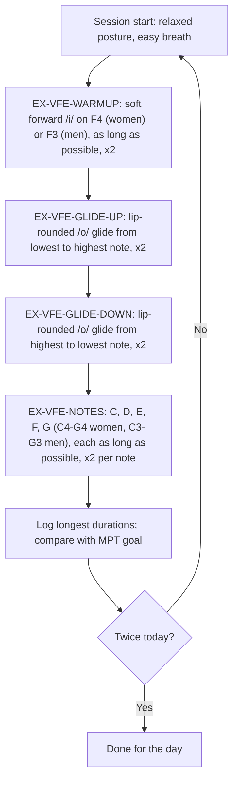

# Vocal Function Exercises (VFE)

## 1. Purpose and scope

This file defines the four Vocal Function Exercises used in the Melo library, summarises their mechanism, evidence, dosage and safety, and states how each one maps to the app's `Exercise` model and to the seed exercises `ex-sustained-ee`, `ex-pitch-glides` and `ex-vfe-notes`. It covers the published protocol as described in peer-reviewed trials; the official VFE materials (Stemple, Plural Publishing) are a commercial product and are not reproduced. Detection algorithms and pass criteria belong to [05-exercise-data](../05-exercise-data/README.md); the measures named here are defined in [03-measures](../03-measures/README.md).

## 2. Summary table

| ID | Exercise | Task (paraphrased) | Default pitch (women / men) | Dose per session | Verification type | Seed id |
|---|---|---|---|---|---|---|
| EX-VFE-WARMUP | Warm-up | Sustain a soft, forward-placed /i/ as long as possible | F4 / F3 [1][2] | 2 trials [1][3] | sustained | `ex-sustained-ee` |
| EX-VFE-GLIDE-UP | Stretching | Soft upward glide, lowest to highest note, on a lip-rounded /o/ | Whole range [1] | 2 trials [1] | glide | `ex-pitch-glides` (partial) |
| EX-VFE-GLIDE-DOWN | Contracting | Soft downward glide, highest to lowest note, same posture | Whole range [1] | 2 trials [1] | glide | `ex-pitch-glides` (partial) |
| EX-VFE-NOTES | Low-impact adductory power | Sustain each of five ascending notes as long as possible on lip-rounded /o/ | C4-G4 / C3-G3 [1][2] | 2 trials per note [1] | notes | `ex-vfe-notes` |

Program-level evidence: **Moderate** (one systematic review of 21 studies with positive effects and no reported adverse events [4]; RCTs in normal, disordered and ageing voices [3][5][6][7]; network meta-analyses in which VFE is the only intervention with a significant maximum phonation time gain [8] and one of four with significant Voice Handicap Index gains [9]).

Standard dosage: each exercise twice, twice a day, every day, for 6 weeks [1][3]. Home-suitable after in-clinic training.

## 3. Body

### 3.1 Mechanism

VFE is a physiologic exercise program first tested as a way to improve aerodynamic efficiency of voice production: in its original trial it increased phonation volume, airflow-related measures, MPT and frequency range [5]. The four exercises are described in exercise-physiology terms: a warm-up, a stretch of the vocal folds (upward glide), a contraction (downward glide), and a low-impact adductory power task (sustained notes) [3]. Every exercise is produced as softly as possible while still voiced, and exercises two to four use a semi-occluded mouth posture: an expanded pharynx with tightly rounded lips so that a sympathetic buzz is felt on the lips [1].

The semi-occlusion matters. In eight men with normal voice, the VFE /ol/-buzz posture immediately raised open quotient and minimum airflow compared with an open /o/, consistent with semi-occluded vocal tract theory [10]. In an RCT with 28 women, the prescribed semi-occluded posture improved maximum phonation time (MPT) over six weeks while modified postures with an open /o/ or /a/ did not [1]. VFE therefore overlaps mechanistically with [semi-occluded vocal tract exercises](sovt.md).

Maximum-duration phonation is a second active ingredient: removing the "as long as possible" requirement removed the significant MPT gain in normal voices, although between-group differences were not significant [11].

### 3.2 Van Stan 2015 taxonomy classification

Van Stan and colleagues classified VFE as a direct intervention that combines vocal function components (soft phonation, sustained notes, pitch glides), respiratory components (sustained phonation on one breath) and musculoskeletal components (posture) [12]. Delivery is extrinsic (clinician models and cues) during training and intrinsic (self-monitoring of buzz, softness and breaks) during home practice.

### 3.3 Indications

| Indication | Link | Evidence |
|---|---|---|
| Primary muscle tension dysphonia | [DX-MTD-PRIMARY](../02-disorders/muscle-tension-dysphonia.md#dx-mtd-primary) | RCT in 40 Vietnamese female teachers [13]; uncontrolled series in 15 Persian-speaking adults [14]; Indian RCT used VFE as active comparator in hyperfunctional dysphonia [15] |
| Teachers and occupational voice users | [DX-OCC-TEACHER](../02-disorders/occupational-voice-users.md#dx-occ-teacher) | RCTs: 58 teachers [6], 162 teachers [16], 37 teachers (prevention) [17] |
| Presbyphonia and vocal fold atrophy | [DX-PRESBY](../02-disorders/presbyphonia.md#dx-presby) | 19 men aged 60-78 over 12 weeks [7]; 9 patients with presbylaryngis [18]; 16 patients aged 65-81 vs historical controls [19]; 22 ageing choral singers [20] |
| Singers (performance enhancement) | [DX-OCC-SINGER](../02-disorders/occupational-voice-users.md#dx-occ-singer) | 20 graduate singers over 4 weeks [21]; 40 opera students over 10 weeks [22] |
| Benign lesions, nodules, oedema | [DX-NODULES](../02-disorders/vocal-fold-nodules.md#dx-nodules) | Mixed diagnoses in a 20-person RCT comparing VFE with tube phonation [2]; Indian four-arm RCT in organic dysphonia [23] |

The AAO-HNS guideline makes a strong recommendation that clinicians advocate voice therapy for dysphonia amenable to it, and recommends laryngoscopy before voice therapy is prescribed [24]. VFE should only be assigned after that diagnosis.

### 3.4 Contraindications and cautions

- No adverse voice outcomes were reported in the 21 studies of the systematic review [4], and no toxic effects were seen even at four repetitions per exercise [3]. Evidence on harm is therefore limited to small, mostly normal-voice samples: **Limited**.
- Not for undiagnosed dysphonia (laryngoscopy first) [24].
- Sustaining "as long as possible" invites squeezing at the end of the breath. The protocol requires soft phonation throughout [1]; the app must not reward length achieved with strain.
- Patients who cannot reach the default notes (for example after radiotherapy, or with severe paresis) need therapist-chosen pitches; no published rule exists for adapting the notes. **Not established.**
- Patients with spasmodic dysphonia, where maximal effortful voicing can worsen symptoms, are outside the evidence base; see [DX-SD](../02-disorders/spasmodic-dysphonia.md#dx-sd).

### 3.5 Protocol (paraphrased)



Steps for EX-VFE-WARMUP [1][2]: take an easy breath; on the target note sustain a soft /i/ with a forward, slightly nasal placement; continue as long as possible without pushing; rest; repeat once.

Steps for EX-VFE-GLIDE-UP [1][2]: form the lip-rounded /o/ posture so the lips buzz; start on the lowest comfortable note; glide slowly to the highest note, aiming for no breaks; repeat once.

Steps for EX-VFE-GLIDE-DOWN [1][2]: same posture; start on the highest note; glide slowly to the lowest note; repeat once. The aim of both glides is to traverse the range without a pitch break [1].

Steps for EX-VFE-NOTES [1][2]: same posture; sustain C as long as possible, softly; rest; repeat; then D, E, F and G. Women use middle C (C4) to G4; men use the same note names one octave lower [2]. Patients log the duration of each note [1].

Pitch targets in hertz (equal temperament, A4 = 440 Hz; arithmetic, not a finding): C3 130.8, D3 146.8, E3 164.8, F3 174.6, G3 196.0, C4 261.6, D4 293.7, E4 329.6, F4 349.2, G4 392.0.

### 3.6 Dosage

| Parameter | Value | Source | Grade |
|---|---|---|---|
| Repetitions per exercise | 2 (each note twice for EX-VFE-NOTES) | [1][3] | Moderate |
| Sessions per day | 2 (morning and evening) | [1][3] | Moderate |
| Days per week | 7 | [3] | Limited |
| Program weeks | 6 (trials range 4 to 12) | [3][6]; 4 [5][21]; 5 [20]; 10 [22]; 12 [7] | Moderate |
| Clinic sessions | Weekly in most trials; 6 weekly sessions of 30-60 min in one RCT [2]; twice weekly 30 min for 6 weeks in the Indian RCT [15] | [2][15] | Limited |
| MPT goal | Maximum airflow volume divided by 80 mL/s | [3] | Expert opinion (Stemple and Hapner recommendation reported in [3]) |
| Session minutes | Not reported in the trials reviewed | none | Not established |

Dose-response: in 28 young women with normal voice, one repetition per exercise twice daily did not improve MPT significantly, two did, and four gave the fastest gain but 50% of that group withdrew; the two-repetition group had the best compliance and lowest withdrawal [3]. Knowing the MPT goal was not shown to matter (Hedges g 0.56, confidence interval crossing zero, 19 completers) [25], and training by a novice versus a 40-year expert produced similar gains (17 completers) [26].

Worked example (dose arithmetic). One session = 2 warm-ups + 2 upward glides + 2 downward glides + (5 notes x 2) = 16 phonations. Twice daily gives 32 phonations a day, 224 a week, and 1,344 over 6 weeks. In the app this is four `Exercise` entries assigned with `repetitions = 2`, `sessionsPerDay = 2`, weekdays `{1..7}`; for EX-VFE-NOTES, `repetitions = 2` means two trials of each of the five notes.

Worked example (MPT goal). A patient with a maximum airflow volume of 4,000 mL has a goal of 4,000 / 80 = 50 s [3]. A phone cannot measure airflow volume, so the therapist must enter the goal from clinic spirometry or pneumotachography; if none is available, the goal is **Not established** and the app should show the patient's own longest trial instead of a target.

Worked example (session time, derived, not published). If each of the 16 phonations averages 20 s and the patient rests 10 s between them, one session lasts 16 x 30 s = 8 min. This is an estimate for the reminder text only; the SLP panel should confirm a typical session length.

### 3.7 Home-practice suitability and teaching

VFE was designed as a home program: trials taught it in clinic and then relied on twice-daily home practice with logs [1][3], practice videos [3] and weekly check-ins [3]. Training by a supervised novice was as effective as by an expert in normal voices [26]. A smartphone app that delivered VFE home practice to normophonic adults halved missed practice tasks versus paper logs (12 vs 13 participants, p = 0.04) [27]. Suitability: **with training**. The patient needs a live demonstration of the semi-occluded /o/ posture and the soft onset, then an audio or video model with reference pitches recorded by the study SLP.

### 3.8 What the patient records and the acoustic signature

| Exercise | What the patient records | Correct attempt | Incorrect attempt | Measures |
|---|---|---|---|---|
| EX-VFE-WARMUP | One take per trial, `sustainedPhonation` | Continuous voicing at the target note, stable F0, low level relative to the patient's speech | Breathy fade or pressed ending; voice breaks; drifting pitch; loud onset | [M-MPT](../03-measures/temporal.md#m-mpt), [M-PITCH-ACCURACY](../03-measures/f0-pitch.md#m-pitch-accuracy), [M-VOICE-BREAKS](../03-measures/temporal.md#m-voice-breaks), [M-LEVEL-RELATIVE](../03-measures/intensity.md#m-level-relative) |
| EX-VFE-GLIDE-UP / DOWN | One take per glide | Monotonic F0 contour covering the patient's range | Breaks at register transitions; plateaus; truncated range | [M-F0-RANGE](../03-measures/f0-pitch.md#m-f0-range), [M-VOICE-BREAKS](../03-measures/temporal.md#m-voice-breaks) |
| EX-VFE-NOTES | One take per note per trial | F0 near the target note; long duration; soft | Off-pitch; short duration; loud or pressed | [M-PITCH-ACCURACY](../03-measures/f0-pitch.md#m-pitch-accuracy), [M-MPT](../03-measures/temporal.md#m-mpt) |

The pitch tolerance for "on target" is not published for VFE. The research doc's plus or minus 50 cents is **Not established** and must be set by the SLP panel (see [05-exercise-data](../05-exercise-data/README.md)).

### 3.9 Progress markers

- Longest sustained duration on EX-VFE-WARMUP and EX-VFE-NOTES rising toward the MPT goal; trials report gains over 4 to 12 weeks [5][7][3]. A network meta-analysis found a mean pre-post MPT gain of 6.16 s (95% CI 1.18 to 11.13) for VFE in dysphonic adults [8].
- Glides completed without breaks.
- Probe measures: [M-MPT](../03-measures/temporal.md#m-mpt) and [M-CPPS-VOWEL](../03-measures/cepstral.md#m-cpps-vowel) (CPP improved more with an eclectic program than VFE in the Indian RCT [15]); patient-reported [PROM-VHI10](../06-interpretation/proms.md#prom-vhi10).
- Not every patient changes acoustically: in presbylaryngis, VHI and effort improved without MPT or acoustic change [18].

### 3.10 Safety signals that stop practice

Stop and contact the therapist on pain, strain or a worse voice during or after practice ([RF-PRACTICE-PAIN](../06-interpretation/red-flags.md#rf-practice-pain)); sudden voice loss ([RF-SUDDEN-VOICE-LOSS](../06-interpretation/red-flags.md#rf-sudden-voice-loss)); a measured decline across probes ([RF-ACOUSTIC-DECLINE](../06-interpretation/red-flags.md#rf-acoustic-decline)). Dizziness from repeated maximal breaths is plausible but unstudied for VFE; the app should advise resting between trials.

### 3.11 Seed mapping

| Seed id | Right | Wrong or missing |
|---|---|---|
| `ex-sustained-ee` | Soft vowel, sustained, 2 x 2, stop before strain | No target note (should be F4 or F3); no forward or nasal placement cue; the 20 s target is invented and should be the patient's MPT goal; "stamina" framing omits the softness rule |
| `ex-pitch-glides` | Smooth glide without breaks, 2 sessions a day | 5 repetitions instead of 2; uses "oo" without the lip-buzz posture; combines up and down glides that the protocol separates; the 12-semitone target is invented (the goal is the full range) |
| `ex-vfe-notes` | Five ascending notes on "ol", soft, 2 x 2 | `pitchHz: 220` (A3) is not a VFE note; women use C4-G4 and men C3-G3; the 8 s duration and 50-cent tolerance are unsourced; the model has one `pitchHz` but the exercise needs five |
| All | Program name | `evidenceSource` should cite Stemple1994, Bane2019a and Angadi2019, not "Research doc 7.2" |

### 3.12 What the app may conclude

- Whether a take was voiced continuously, its duration, and its F0 relative to the assigned note.
- Whether the patient's longest durations are rising across sessions, stated as a practice trend.

### 3.13 What the app must not conclude

- That a longer duration means the voice disorder is improving or resolved.
- That the patient's technique is correct; softness and lip posture cannot be fully judged from audio.
- That the patient should change pitch, dose or exercise; only the therapist adjusts these.

## 4. Conflicting evidence

- **Dose.** Bane found low dose insufficient and high dose effective but poorly tolerated [3], while a teacher RCT reported benefit only in participants who adhered [6]. Kapsner-Smith raised home frequency to four times daily to match a tube program [2]. The optimal dose for disordered voices is unknown.
- **Comparative effect.** VFE was the only intervention with a significant MPT gain in one network meta-analysis [8], but in the VHI network meta-analysis stretch-and-flow phonation had the largest effect [9]; tube phonation was non-inferior to VFE on VHI in a 20-person RCT [2]; and in the Indian RCT an eclectic program outperformed VFE on stroboscopic closure, CPP and perceptual strain [15].
- **Acoustic change.** Several studies report MPT and aerodynamic change [5][7][21], whereas a presbylaryngis series found self-reported and perceptual change without MPT or acoustic change [18].

## 5. Gaps and open questions

- Dose-response in dysphonic patients (all dose trials used normal voices) [3][11][25][26].
- A 4-week pilot is shorter than the 6-week standard; gains may be underestimated. Whether to extend the pilot is an SLP panel question.
- No validated phone-based method to set the MPT goal without airflow measurement.
- Pitch tolerance for EX-VFE-NOTES and glide range criteria: **Not established**. Study design: SLP-rated correct and incorrect takes (10-20 per exercise per patient group) compared against candidate cent tolerances, choosing the tolerance that maximises agreement (kappa) with SLP judgement.
- Indian data: one RCT used VFE as comparator in Tamil-speaking patients [15] and one four-arm RCT included VFE [23]; no Hindi or Punjabi VFE study was found.

## 6. Implementation in Melo

- Feature and layer: `lib/features/exercises/domain/` (models) and `lib/features/demo_data/data/demo_program.dart` (seed content).
- Existing classes: `Exercise`, `ExerciseTargets`, `VerificationType.sustained`, `.glide`, `.notes`, `Schedule.repetitions`, `Schedule.sessionsPerDay`.
- Gaps in the model: EX-VFE-NOTES needs a note sequence, and EX-VFE-WARMUP's duration target is a per-patient MPT goal. Proposed signatures:

```dart
// ExerciseTargets
final List<double>? pitchSequenceHz; // five VFE notes, set per patient sex or range
final double? mptGoalSec;            // therapist-entered; null when no airflow data
```

- Recording: practice takes use `RecordingKind.practice` with `RecordingTask.sustainedPhonation` (warm-up, notes) or a proposed `proposed_vfeGlide` task for glides; verification runs on device, live or immediately after the take (see 05-exercise-data).
- On device vs offline: duration, F0 and voice breaks on device; CPPS and AVQI from probes offline or post-hoc.
- Data file: [../data/exercises.yaml](../data/exercises.yaml) entries EX-VFE-WARMUP, EX-VFE-GLIDE-UP, EX-VFE-GLIDE-DOWN, EX-VFE-NOTES.

<a id="ex-vfe-warmup"></a>
### EX-VFE-WARMUP: Warm-up sustained /i/

Soft, forward-placed /i/ on F4 (women) or F3 (men), as long as possible, twice per session, twice daily [1][2][3]. Verification: sustained. Target: MPT goal from airflow volume [3], otherwise the patient's best trial.

<a id="ex-vfe-glide-up"></a>
### EX-VFE-GLIDE-UP: Upward glide (stretching)

Soft upward glide on lip-rounded /o/ from lowest to highest note without breaks, twice per session [1][2]. Verification: glide. Target range: the patient's full range; no fixed semitone target is published.

<a id="ex-vfe-glide-down"></a>
### EX-VFE-GLIDE-DOWN: Downward glide (contracting)

Soft downward glide on lip-rounded /o/ from highest to lowest note, twice per session [1][2]. Verification: glide.

<a id="ex-vfe-notes"></a>
### EX-VFE-NOTES: Sustained notes (low-impact adductory power)

Five ascending notes C-G (C4-G4 women, C3-G3 men), each sustained as long as possible on lip-rounded /o/, twice per note per session [1][2]. Verification: notes.

## 7. References

1. [Bane2019b] Bane M, Brown M, Angadi V, et al. 2019. Vocal function exercises for normal voice: With and without semi-occlusion. Int J Speech Lang Pathol 21(2):175-181. doi:10.1080/17549507.2017.1416176
2. [KapsnerSmith2015] Kapsner-Smith MR, Hunter EJ, Kirkham K, et al. 2015. A randomized controlled trial of two semi-occluded vocal tract voice therapy protocols. J Speech Lang Hear Res 58(3):535-549. doi:10.1044/2015_JSLHR-S-13-0231
3. [Bane2019a] Bane M, Angadi V, Dressler E, et al. 2019. Vocal function exercises for normal voice: The effects of varying dosage. Int J Speech Lang Pathol 21(1):37-45. doi:10.1080/17549507.2017.1373858
4. [Angadi2019] Angadi V, Croake D, Stemple J. 2019. Effects of vocal function exercises: A systematic review. J Voice 33(1):124.e13-124.e34. doi:10.1016/j.jvoice.2017.08.031
5. [Stemple1994] Stemple JC, Lee L, D'Amico B, et al. 1994. Efficacy of vocal function exercises as a method of improving voice production. J Voice 8(3):271-278. doi:10.1016/s0892-1997(05)80299-1
6. [Roy2001] Roy N, Gray SD, Simon M, et al. 2001. An evaluation of the effects of two treatment approaches for teachers with voice disorders: a prospective randomized clinical trial. J Speech Lang Hear Res 44(2):286-296. doi:10.1044/1092-4388(2001/023)
7. [Gorman2008] Gorman S, Weinrich B, Lee L, et al. 2008. Aerodynamic changes as a result of vocal function exercises in elderly men. Laryngoscope 118(10):1900-1903. doi:10.1097/MLG.0b013e31817f9822
8. [BarstiesVLatoszek2023a] Barsties v. Latoszek B, Watts CR, Schwan K, et al. 2023. The maximum phonation time as marker for voice treatment efficacy: A network meta-analysis. Clin Otolaryngol 48(2):130-138. doi:10.1111/coa.14019
9. [BarstiesVLatoszek2020] Barsties v. Latoszek B, Watts CR, Neumann K. 2020. The effectiveness of voice therapy on voice-related handicap: A network meta-analysis. Clin Otolaryngol 45(5):796-804. doi:10.1111/coa.13596
10. [Croake2017] Croake DJ, Andreatta RD, Stemple JC. 2017. Immediate effects of the vocal function exercises semi-occluded mouth posture on glottal airflow parameters: A preliminary study. J Voice 31(2):245.e9-245.e14. doi:10.1016/j.jvoice.2016.08.009
11. [Bane2025a] Bane M, Morton M, Angadi V, et al. 2025. Vocal function exercises with and without maximally sustained phonation: A randomized controlled trial of individuals with normal voice. J Voice 39(2):410-417. PMID 36379827
12. [VanStan2015] Van Stan JH, Roy N, Awan S, et al. 2015. A taxonomy of voice therapy. Am J Speech Lang Pathol 24(2):101-125. doi:10.1044/2015_AJSLP-14-0030
13. [Nguyen2009] Nguyen DD, Kenny DT. 2009. Randomized controlled trial of vocal function exercises on muscle tension dysphonia in Vietnamese female teachers. J Otolaryngol Head Neck Surg 38(2):261-278. PMID 19442378
14. [Jafari2017] Jafari N, Salehi A, Izadi F, et al. 2017. Vocal function exercises for muscle tension dysphonia: Auditory-perceptual evaluation and self-assessment rating. J Voice 31(4):506.e25-506.e31. PMID 27993500
15. [Mahalingam2026] Mahalingam S, Boominathan P, Arunachalam R, et al. 2026. Evaluation of an eclectic voice therapy program and vocal function exercise (VFE) in hyperfunctional voice disorders: A randomised controlled trial. J Commun Disord 119:106594. doi:10.1016/j.jcomdis.2025.106594
16. [Teixeira2015] Teixeira LC, Behlau M. 2015. Comparison between vocal function exercises and voice amplification. J Voice 29(6):718-726. doi:10.1016/j.jvoice.2014.12.012
17. [Pasa2007] Pasa G, Oates J, Dacakis G. 2007. The relative effectiveness of vocal hygiene training and vocal function exercises in preventing voice disorders in primary school teachers. Logoped Phoniatr Vocol 32(3):128-140. doi:10.1080/14015430701207774
18. [Sauder2010] Sauder C, Roy N, Tanner K, et al. 2010. Vocal function exercises for presbylaryngis: a multidimensional assessment of treatment outcomes. Ann Otol Rhinol Laryngol 119(7):460-467. doi:10.1177/000348941011900706
19. [Kaneko2015] Kaneko M, Hirano S, Tateya I, et al. 2015. Multidimensional analysis on the effect of vocal function exercises on aged vocal fold atrophy. J Voice 29(5):638-644. doi:10.1016/j.jvoice.2014.10.017
20. [Tay2012] Tay EY, Phyland DJ, Oates J. 2012. The effect of vocal function exercises on the voices of aging community choral singers. J Voice 26(5):672.e19-672.e27. doi:10.1016/j.jvoice.2011.12.014
21. [Sabol1995] Sabol JW, Lee L, Stemple JC. 1995. The value of vocal function exercises in the practice regimen of singers. J Voice 9(1):27-36. doi:10.1016/s0892-1997(05)80220-6
22. [Guzman2020] Guzman M, Angadi V, Croake D, et al. 2020. Does a systematic vocal exercise program enhance the physiologic range of voice production in classical singing graduate-level students? J Speech Lang Hear Res 63(4):1044-1052. doi:10.1044/2020_JSLHR-19-00362
23. [Narasimhan2025] Narasimhan SV, Raju M, Shivaramu N, et al. 2025. The impact of semi-occluded vocal tract exercises on multidimensional measures of voice in dysphonia: A randomized controlled study. J Voice (online ahead of print). doi:10.1016/j.jvoice.2025.05.007
24. [AAOHNS2018] Stachler RJ, Francis DO, Schwartz SR, et al. 2018. Clinical practice guideline: Hoarseness (dysphonia) (update). Otolaryngol Head Neck Surg 158(1_suppl):S1-S42. doi:10.1177/0194599817751030
25. [Bane2025b] Bane M, Angadi V, Andreatta R, et al. 2025. The effect of maximum phonation time goal on efficacy of vocal function exercises. J Voice 39(5):1254-1261. doi:10.1016/j.jvoice.2023.03.009
26. [Bane2026] Bane M, Angadi V, Andreatta R, et al. 2026. Effect of clinical expertise on efficacy of vocal function exercises in individuals with typical voice. J Voice 40(2):369-375. doi:10.1016/j.jvoice.2023.11.002
27. [Angadi2023] Angadi V, Chih MY, Stemple J. 2023. Developing and testing a smartphone application to enhance adherence to voice therapy: A pilot study. Int J Environ Res Public Health 20(3):2436. doi:10.3390/ijerph20032436

## 8. Last searched

2026-10-09. PubMed (NCBI E-utilities), Europe PMC REST API, PubMed Central full text (Bane2019a, Bane2019b, Kapsner-Smith2015, Van Stan2015).
