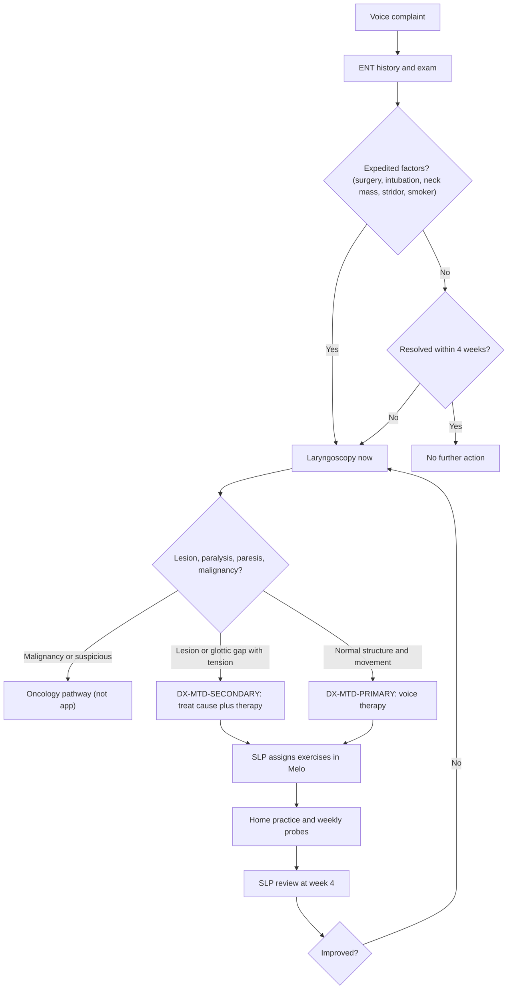

# Muscle tension dysphonia (primary and secondary)

## 1. Purpose and scope

This file profiles muscle tension dysphonia (MTD) for Melo: what it is, how common it is, how it sounds and measures, which exercise programs have evidence, how fast change is expected, and what the app may and may not infer from home recordings. It defines two IDs: [DX-MTD-PRIMARY](#dx-mtd-primary) (MTD with no structural or neurological cause) and [DX-MTD-SECONDARY](#dx-mtd-secondary) (excess laryngeal muscle tension that accompanies or compensates for another laryngeal condition).

The diagnosis is made by the treating ENT and SLP after laryngoscopy. The app stores a therapist-entered diagnosis code and never infers one.

## 2. Summary table

| Item | Primary MTD (DX-MTD-PRIMARY) | Secondary MTD (DX-MTD-SECONDARY) |
|---|---|---|
| Definition | Dysphonia from excess or dysregulated (para)laryngeal muscle activity, no organic or neurological lesion [1][2] | Excess tension that accompanies or compensates for a lesion, glottic gap, reflux or infection [1] |
| Share of voice-clinic caseload | About 10% of a US voice centre caseload met strict primary MTD criteria (92 of 983) [3] | Not established as a separate figure |
| Key acoustic shifts | Lower CPP (vowel and speech), higher AVQI, shorter MPT; large overlap with other disorders [3][4][5] | Shifts of the underlying condition plus the same tension pattern |
| First-line management | Voice therapy (direct plus indirect) **Moderate** [6]; manual circumlaryngeal therapy **Moderate** for acoustic change [7] | Treat the underlying condition plus voice therapy [8][1] **Expert opinion** |
| Typical time course | Change can start within one session of manual therapy [9]; most trials use 4 to 8 weeks [5][10][11] | Depends on the primary condition |
| Laryngoscopy before therapy | Required (AAO-HNS recommendation) [8] | Required [8] |
| Main risk for the app | Labelling a voice as "tense" when the cause is a lesion, paralysis or cancer | Treating the tension and missing the cause |

## 3. Body

### DX-MTD-PRIMARY: Primary muscle tension dysphonia

**Definition.** MTD is a clinical term for disturbed vocal fold behaviour caused by increased tension of the laryngeal and paralaryngeal muscles [1]. Primary MTD is diagnosed when no structural (mass, scar, atrophy) or neurological (paralysis, paresis, dystonia, tremor) cause explains the dysphonia [2][3]. Older literature calls it functional dysphonia, hyperfunctional dysphonia or muscle misuse voice disorder [12].

**Pathophysiology.** No single mechanism is proven. An integrative review of 100 papers grouped the proposed mechanisms into seven categories (psychosocial, autonomic, sensorimotor, respiratory, postural, inflammatory, neuromuscular) and modelled primary MTD as an idiosyncratic motor adaptation to a physical or perceived threat that can persist after the trigger is gone [2] **Limited**. Earlier reviews named three causal groups: psychological or personality factors, vocal misuse, and compensation for underlying disease [1]. The updated vocal hyperfunction framework separates non-phonotraumatic vocal hyperfunction (which includes primary MTD, no tissue damage) from phonotraumatic hyperfunction (nodules, polyps) [13] **Expert opinion**.

### DX-MTD-SECONDARY: Secondary muscle tension dysphonia

**Definition.** Excess tension that develops alongside, or as compensation for, another condition: reflux, upper airway infection, benign lesions, or glottic insufficiency [1]. Morrison and Rammage noted that persistent phonation with abnormal laryngeal posture can itself lead to organic changes such as nodules or polyps [12]. Clinically, this is why a tense voice pattern is not a diagnosis in itself: the tension may be the visible half of a lesion, a paresis or presbyphonia. See [DX-VF-PARESIS](vocal-fold-paralysis-paresis.md#dx-vf-paresis), [DX-PRESBY](presbyphonia.md#dx-presby), [DX-LPR](lpr-dysphonia.md#dx-lpr) and [DX-NODULES](vocal-fold-nodules.md#dx-nodules).

### Prevalence and demographics

| Population | Finding | Source |
|---|---|---|
| US tertiary voice centre, 983 patients over two years | 92 (about 10%) met strict primary MTD criteria | [3] |
| Belgian university ENT clinic, 882 dysphonic patients (stroboscopy, ages 4 to 90) | Functional voice disorders were the commonest diagnosis, 30% overall and 41% of professional voice users | [14] |
| Indian rural teaching hospital (Sewagram), 100 hoarse patients, stroboscopy | Functional disorders 14% of cases; vocal fold paralysis 33% | [15] |
| Indian tertiary centre, 48 adults with primary MTD | Cohort used for correlating AVQI, ABI, GRBAS, VHI and VFI; no prevalence figure | [16] |

The MTD-specific sex and age distribution is not reported in the abstracts above. General voice-disorder surveys show more women than men report voice problems (see [occupational-voice-users.md](occupational-voice-users.md)). Indian ENT series are dominated by men, smokers and serious pathology (malignancy was the commonest cause in a Ballari series, 38.6% of 70 patients [17]), so Indian referral data cannot be used to estimate MTD prevalence. No Indian population prevalence data for MTD found.

### Perceptual profile

Reported features are strain and roughness, sometimes breathiness or pitch that is too high or too low for the speaker, with effort and throat discomfort as symptoms [1][3]. On GRBAS the expected pattern is raised G and S, variable R and B; on CAPE-V, raised overall severity and strain ([M-GRBAS](../03-measures/perceptual-reference.md#m-grbas), [M-CAPEV](../03-measures/perceptual-reference.md#m-capev)). In an Indian primary MTD cohort, GRBAS correlated moderately to very highly with AVQI and ABI (rho 0.48 to 0.87), while aerodynamic measures did not correlate with other measures [16] **Limited**.

### Acoustic profile

| Measure | Direction vs healthy | Strength of evidence | Source |
|---|---|---|---|
| [M-CPPS-VOWEL](../03-measures/cepstral.md#m-cpps-vowel) | Lower | Group difference significant, but distributions overlap heavily with other disorders | [3][4] |
| [M-CPPS-SPEECH](../03-measures/cepstral.md#m-cpps-speech) | Lower; rises with successful therapy (d = 1.2); a cepstral-spectral index of speech was the measure that improved after primary MTD treatment in a 10-patient series | One small RCT; one small series | [5][18] |
| [M-AVQI](../03-measures/composite-indices.md#m-avqi) | Higher (worse); falls with therapy | RCT with both arms improving | [10] |
| [M-HNR](../03-measures/noise.md#m-hnr) | Lower; rises about 4.65 dB after manual therapy | Meta-analysis of 6 uncontrolled studies | [7] |
| [M-JITTER-LOCAL](../03-measures/perturbation.md#m-jitter-local), [M-SHIMMER-LOCAL](../03-measures/perturbation.md#m-shimmer-local) | Higher; fall after manual therapy | Same meta-analysis | [7] |
| [M-MPT](../03-measures/temporal.md#m-mpt) | Shorter; lengthens with therapy (d = 1.2) | One small RCT | [5] |
| [M-F0-MEAN](../03-measures/f0-pitch.md#m-f0-mean), [M-F0-RANGE](../03-measures/f0-pitch.md#m-f0-range) | Highest F0 differs from other disorders; direction for MTD not consistent across studies | Single cohort; MCT effect on F0 not verified | [3][7] |
| [M-SZ-RATIO](../03-measures/temporal.md#m-sz-ratio) | Reported as an outcome; no consistent MTD-specific shift | Single RCT | [5] |

Two cautions apply. First, a random-forest model on 15 ASHA-recommended metrics explained only 65% of the variance separating primary MTD from other disorders [3]: the acoustic profile is not specific. Second, the CPP cut-offs that separate disordered from healthy voices (Praat 14.45 dB for /a/, 9.33 dB for the Rainbow Passage) were derived from mixed diagnoses, not MTD alone [19].

### Why laryngoscopy is required before therapy

- The AAO-HNS guideline recommends diagnostic laryngoscopy before voice therapy is prescribed, with results communicated to the SLP, and laryngoscopy whenever dysphonia does not resolve within 4 weeks or a serious cause is suspected [8] **Strong** (guideline).
- Primary MTD is a diagnosis of exclusion [2][3]. Tension signs seen on endoscopy (false fold or anterior-posterior compression) occur in many healthy speakers: false-fold compression in 45% of controls and anterior-posterior compression in 74% [20], and one compression pattern did not separate MTD from normal voices in a second study [4]. Without imaging, tension cannot be distinguished from the compensation that accompanies a lesion, paresis or cancer.
- In Indian ENT series, the conditions that MTD can mimic are common: laryngeal malignancy was the commonest cause in two series [17][21] and vocal fold paralysis accounted for 33% of another [15].

### Recommended therapy

| Program (exercise IDs) | Evidence | Grade |
|---|---|---|
| Combined direct and indirect voice therapy | Cochrane review, 6 RCTs (163 treated, 141 controls); improvement in self-rated voice (SMD -1.07), observer ratings and instrumental measures; effect lasted at least 14 weeks in one trial [6] | **Moderate** |
| Manual circumlaryngeal therapy ([EX-MANUAL-CLM](../01-exercises/manual-therapy.md#ex-manual-clm)); home self-massage ([EX-MANUAL-SELF-MASSAGE](../01-exercises/manual-therapy.md#ex-manual-self-massage)) | Meta-analysis of 6 studies, large acoustic effects [7]; single-session gains maintained at follow-up [9]; acoustic index tracked change in 88 women [22]. Self-massage at home has no direct trial evidence | **Moderate** (clinician-delivered); **Expert opinion** (home self-massage) |
| Stretch-and-flow (flow phonation: [EX-FLOW-BREATHY-ONSET](../01-exercises/flow-phonation.md#ex-flow-breathy-onset), [EX-FLOW-SUSTAINED-AIRFLOW](../01-exercises/flow-phonation.md#ex-flow-sustained-airflow)) | RCT vs hygiene only (6 weeks): large gains in VHI, MPT and CPP [5]; non-inferior to RVT [10] | **Moderate** (small RCTs) |
| Resonant voice therapy ([EX-RVT-BTG](../01-exercises/resonant-voice-therapy.md#ex-rvt-btg), [EX-RVT-CHANT-SPEECH](../01-exercises/resonant-voice-therapy.md#ex-rvt-chant-speech)) | Improved VHI, AVQI and CPPS in an RCT arm (n = 9) [10] | **Limited** |
| SOVT ([EX-SOVT-STRAW](../01-exercises/sovt.md#ex-sovt-straw), [EX-SOVT-LIP-TRILL](../01-exercises/sovt.md#ex-sovt-lip-trill)) and VFE ([EX-VFE-WARMUP](../01-exercises/vocal-function-exercises.md#ex-vfe-warmup)) | Included in a systematic review of 9 trials with positive but methodologically weak results [23] | **Limited** |
| Conversation training therapy ([EX-CTT](../01-exercises/conversation-training-therapy.md#ex-ctt)) | Prospective study vs historical matched controls: 2 CTT sessions matched gains of 4 to 8 traditional sessions [24] | **Limited** |
| Laryngeal reposturing ([EX-REPOSTURE](../01-exercises/laryngeal-reposturing.md#ex-reposture)), yawn-sigh ([EX-FAC-YAWN-SIGH](../01-exercises/facilitating-techniques.md#ex-fac-yawn-sigh)) | Used within direct therapy packages [1]; no isolated trial found in this search | **Expert opinion** |
| Vocal hygiene alone ([EX-HYG-HYDRATION](../01-exercises/vocal-hygiene.md#ex-hyg-hydration)) | Indirect therapy alone was not effective vs no treatment in the one trial in the Cochrane review [6] | **Moderate** (against use alone) |

### Medical and surgical context

Primary MTD is managed behaviourally [1]. For secondary MTD, the underlying condition is treated (reflux, lesion surgery, glottic insufficiency) and voice therapy addresses the tension [8][1] **Expert opinion**. The AAO-HNS guideline advises against antireflux medication for isolated dysphonia without laryngoscopy and against routine antibiotics [8].

### Expected time course

| Evidence | Time | Source |
|---|---|---|
| Manual circumlaryngeal therapy | Significant change after one session, maintained at follow-up; 68% had brief partial recurrences (usually under 4 days) | [9] |
| Conversation training therapy | Gains after 2 sessions equivalent to 4 to 8 traditional sessions | [24] |
| Twice-weekly therapy for 4 weeks vs weekly for 8 weeks | Same final outcome; faster with the intensive schedule | [11] |
| Stretch-and-flow and RVT | 6 weekly sessions | [5][10] |

A 4-week home program in a patient with confirmed primary MTD can plausibly show measurable change in CPPS and MPT if the patient also receives clinician sessions, because the trials above show change within that window. Home practice alone without clinician sessions has not been tested for MTD. Brief relapses are expected [9] and are not a sign of failure.

### Red flags

The app escalates, never interprets, the following: [RF-PERSISTENT-HOARSENESS](../06-interpretation/red-flags.md#rf-persistent-hoarseness), [RF-PRACTICE-PAIN](../06-interpretation/red-flags.md#rf-practice-pain), [RF-SUDDEN-VOICE-LOSS](../06-interpretation/red-flags.md#rf-sudden-voice-loss), [RF-DYSPHAGIA](../06-interpretation/red-flags.md#rf-dysphagia), [RF-ACOUSTIC-DECLINE](../06-interpretation/red-flags.md#rf-acoustic-decline), [RF-DISTRESS](../06-interpretation/red-flags.md#rf-distress) (psychosocial factors are part of the proposed mechanism [2]).

### Care pathway

### Worked example

Inputs are illustrative; the thresholds and expected change come from the cited sources.

A 34-year-old woman with laryngoscopy-confirmed primary MTD records three baseline sustained /a/ trials. HNR values are 14.1, 15.0 and 15.9 dB (mean 15.0, SD 0.9 dB). Using the feedback-engine formula in research doc section 6, the personal MDC95 is 1.96 x sqrt(2) x 0.9 = 2.49 dB. The manual circumlaryngeal therapy meta-analysis reports a mean HNR gain of 4.65 dB (95% CI 1.90 to 7.41) [7]. If she responds like the average patient in those studies, her follow-up mean of about 19.7 dB exceeds baseline by more than her MDC95 and the metric is classed Improved. If she responds at the lower confidence bound (1.90 dB), the change stays inside her MDC95 and is classed Stable, even though it may be real. Her baseline CPP from Praat of, say, 12.8 dB on /a/ is below the 14.45 dB mixed-diagnosis cut-off [19]; that comparison says nothing about MTD specifically and must not be shown to her as a diagnosis.

### What a 4-week home program can and cannot show

- Can show: adherence, whether within-patient CPPS, MPT and AVQI move beyond personal measurement error, and self-reported effort.
- Cannot show: that tension has resolved at the laryngeal level (needs laryngoscopy and palpation), that the cause is primary rather than secondary, or long-term relapse risk.

### What the app may conclude

- That a therapist-entered diagnosis of primary or secondary MTD is on file, with the laryngoscopy date.
- That a patient's measured values changed beyond their personal measurement error since baseline, in a stated direction, under recorded conditions.
- That practice adherence is above or below the study threshold.

### What the app must not conclude

- That a patient has MTD, or does not, from acoustics. The acoustic profile overlaps heavily with other disorders [3].
- That a tense-sounding voice is "just tension" and therapy can start without laryngoscopy [8].
- That a single bad day is a relapse; brief recurrences are common after successful treatment [9].

## 4. Conflicting evidence

- **Classification.** Morrison and Rammage built a classification on laryngoscopic tension patterns [12]. Later studies found the same supraglottic patterns in many healthy speakers [20][4], and an integrative review proposed a mechanism-based rather than appearance-based model [2]. The app should store the clinician's label, not a pattern type.
- **Acoustic discrimination.** One study found CPP and MPT analyses clinically useful for MTD versus normal [4]; a larger study found substantial overlap between primary MTD and other voice disorders [3]. Both can be true: acoustics separate disordered from normal better than one disorder from another.
- **Manual therapy and F0.** Manual therapy improved jitter, shimmer and HNR in a meta-analysis, but its effect on F0 could not be verified [7].

## 5. Gaps and open questions

- No Indian prevalence data for MTD, and no Hindi or Punjabi acoustic data for MTD found.
- No trial of home-only, app-supported practice for MTD. A randomized trial comparing clinician therapy plus app-supported home practice against clinician therapy alone, with CPPS and VHI-10 at 4 and 12 weeks, would establish its added value.
- Smartphone-recorded MTD-specific change values (MDC, MCID) are Not established. A test-retest study of 30 or more patients with primary MTD recording twice within a week before therapy would establish them.
- Home self-massage effectiveness is Not established.

## 6. Implementation in Melo

- **Feature and layer.** A therapist-entered diagnosis belongs in a new domain file `lib/features/study/domain/diagnosis.dart` (shared across all disorder files; see [README.md](README.md#shared-implementation-contract)), with a Hive repository in `lib/features/study/data/` using a new encrypted `diagnoses` box.
- **Fields.** `DiagnosisCode.mtdPrimary` and `DiagnosisCode.mtdSecondary`. For secondary MTD the therapist also records the underlying code (for example `DiagnosisCode.vfParesis`) so the primary measures follow the cause.
- **Measure emphasis.** `DisorderMeasureProfile` for both codes: primary [M-CPPS-VOWEL](../03-measures/cepstral.md#m-cpps-vowel), [M-CPPS-SPEECH](../03-measures/cepstral.md#m-cpps-speech), [M-AVQI](../03-measures/composite-indices.md#m-avqi), [M-MPT](../03-measures/temporal.md#m-mpt); secondary [M-HNR](../03-measures/noise.md#m-hnr), [M-SHIMMER-LOCAL](../03-measures/perturbation.md#m-shimmer-local). Add a self-reported effort rating ([PROM-EFFORT](../06-interpretation/proms.md#prom-effort)) because effort is a core symptom.
- **Interfaces.** `DisorderMeasureProfile profileFor(Set<DiagnosisCode> codes)` in `lib/features/study/domain/disorder_profiles.dart`; `AnalysisService` is unchanged, the profile only selects which outputs the therapist sees first.
- **On-device vs offline.** Profile lookup is a pure on-device rule. Acoustic analysis placement follows `../07-signal-processing/`.
- **Data file.** No YAML is owned by this folder. The measure lists feed `docs/research/data/status-rules.yaml` (Agent 6) as disorder-specific primary metrics.

## 7. References

1. [VanHoutte2011] Van Houtte E, Van Lierde K, Claeys S. 2011. Pathophysiology and treatment of muscle tension dysphonia: a review of the current knowledge. J Voice 25(2):202-207. doi:10.1016/j.jvoice.2009.10.009. PMID 20400263.
2. [Desjardins2022] Desjardins M, Apfelbach C, Rubino M, et al. 2022. Integrative Review and Framework of Suggested Mechanisms in Primary Muscle Tension Dysphonia. J Speech Lang Hear Res 65(5):1867-1893. doi:10.1044/2022_JSLHR-21-00575. PMID 35446683.
3. [Shembel2023] Shembel AC, Lee J, Sacher JR, et al. 2023. Characterization of Primary Muscle Tension Dysphonia Using Acoustic and Aerodynamic Voice Metrics. J Voice 37(6):897-906. doi:10.1016/j.jvoice.2021.05.019. PMID 34281751.
4. [Dabirmoghaddam2021] Dabirmoghaddam P, Aghajanzadeh M, Erfanian R, et al. 2021. Comparative Study of Increased Supraglottic Activity in Normal Individuals and those with Muscle Tension Dysphonia (MTD). J Voice 35(4):554-558. doi:10.1016/j.jvoice.2019.12.003. PMID 31883850.
5. [Watts2015] Watts CR, Hamilton A, Toles L, et al. 2015. A randomized controlled trial of stretch-and-flow voice therapy for muscle tension dysphonia. Laryngoscope 125(6):1420-1425. doi:10.1002/lary.25155. PMID 25641591.
6. [Ruotsalainen2007] Ruotsalainen JH, Sellman J, Lehto L, et al. 2007. Interventions for treating functional dysphonia in adults. Cochrane Database Syst Rev (3):CD006373. doi:10.1002/14651858.CD006373.pub2. PMID 17636842.
7. [BarstiesVLatoszek2024] Barsties v Latoszek B, Watts CR, Hetjens S. 2024. The Efficacy of the Manual Circumlaryngeal Therapy for Muscle Tension Dysphonia: A Systematic Review and Meta-analysis. Laryngoscope 134(1):18-26. doi:10.1002/lary.30850. PMID 37366280.
8. [AAOHNS2018] Stachler RJ, Francis DO, Schwartz SR, et al. 2018. Clinical Practice Guideline: Hoarseness (Dysphonia) (Update). Otolaryngol Head Neck Surg 158(1_suppl):S1-S42. doi:10.1177/0194599817751030. PMID 29494321.
9. [Roy1997] Roy N, Bless DM, Heisey D, et al. 1997. Manual circumlaryngeal therapy for functional dysphonia: an evaluation of short- and long-term treatment outcomes. J Voice 11(3):321-331. doi:10.1016/s0892-1997(97)80011-2. PMID 9297677.
10. [Watts2019] Watts CR, Hamilton A, Toles L, et al. 2019. Intervention Outcomes of Two Treatments for Muscle Tension Dysphonia: A Randomized Controlled Trial. J Speech Lang Hear Res 62(2):272-282. doi:10.1044/2018_JSLHR-S-18-0118. PMID 30950698.
11. [Chang2025] Chang CW, Fu S, Yu YH, et al. 2025. Bi-Weekly Voice Therapy Versus Weekly Voice Therapy for Muscle Tension Dysphonia. J Voice 39(6):1698.e1-1698.e7. doi:10.1016/j.jvoice.2023.07.004. PMID 37661523.
12. [Morrison1993] Morrison MD, Rammage LA. 1993. Muscle misuse voice disorders: description and classification. Acta Otolaryngol 113(3):428-434. doi:10.3109/00016489309135839. PMID 8517149.
13. [Hillman2020] Hillman RE, Stepp CE, Van Stan JH, et al. 2020. An Updated Theoretical Framework for Vocal Hyperfunction. Am J Speech Lang Pathol 29(4):2254-2260. doi:10.1044/2020_AJSLP-20-00104. PMID 33007164.
14. [VanHoutte2010] Van Houtte E, Van Lierde K, D'Haeseleer E, et al. 2010. The prevalence of laryngeal pathology in a treatment-seeking population with dysphonia. Laryngoscope 120(2):306-312. doi:10.1002/lary.20696. PMID 19957345.
15. [Pal2014] Pal KS, Kaushal AK, Nagpure PS, et al. 2014. Etiopathological study of 100 patients of hoarseness of voice: in a rural based hospital. Indian J Otolaryngol Head Neck Surg 66(1):40-45. doi:10.1007/s12070-013-0660-8. PMID 24605300.
16. [Benoy2024] Benoy JJ, Jayakumar T. 2024. Correlation of Multiple Measures of Voice Evaluation Among Individuals with Muscle Tension Dysphonia: An Exploratory Study. Indian J Otolaryngol Head Neck Surg 76(6):5285-5292. doi:10.1007/s12070-024-04964-6. PMID 39559089.
17. [Vivek2022] Vivek S, Shankar G. 2022. Changing Trend in the Etiological Spectrum of Hoarseness of Voice in Rural India: A Prospective Hospital-Based Study. Indian J Otolaryngol Head Neck Surg 74(Suppl 2):1896-1901. doi:10.1007/s12070-020-01902-0. PMID 36452701.
18. [Gillespie2014] Gillespie AI, Dastolfo C, Magid N, et al. 2014. Acoustic analysis of four common voice diagnoses: moving toward disorder-specific assessment. J Voice 28(5):582-588. doi:10.1016/j.jvoice.2014.02.002. PMID 24880672.
19. [Murton2020] Murton O, Hillman R, Mehta D. 2020. Cepstral Peak Prominence Values for Clinical Voice Evaluation. Am J Speech Lang Pathol 29(3):1596-1607. doi:10.1044/2020_AJSLP-20-00001. PMID 32658592.
20. [Stager2000] Stager SV, Bielamowicz SA, Regnell JR, et al. 2000. Supraglottic activity: evidence of vocal hyperfunction or laryngeal articulation? J Speech Lang Hear Res 43(1):229-238. doi:10.1044/jslhr.4301.229. PMID 10668665.
21. [Chavan2022] Chavan A, Maran R, Chavan G. 2022. Dysphonia: Epidemiology, Diagnosis and Risk Factors at Tertiary Health Care Center. Indian J Otolaryngol Head Neck Surg 74(Suppl 3):5611-5615. doi:10.1007/s12070-021-02952-8. PMID 36742701.
22. [Awan2009] Awan SN, Roy N. 2009. Outcomes measurement in voice disorders: application of an acoustic index of dysphonia severity. J Speech Lang Hear Res 52(2):482-499. doi:10.1044/1092-4388(2009/08-0034). PMID 19339702.
23. [DaCunhaPereira2018] da Cunha Pereira G, de Oliveira Lemos I, Dalbosco Gadenz C, et al. 2018. Effects of Voice Therapy on Muscle Tension Dysphonia: A Systematic Literature Review. J Voice 32(5):546-552. doi:10.1016/j.jvoice.2017.06.015. PMID 28739332.
24. [Gillespie2019] Gillespie AI, Yabes J, Rosen CA, et al. 2019. Efficacy of Conversation Training Therapy for Patients With Benign Vocal Fold Lesions and Muscle Tension Dysphonia Compared to Historical Matched Control Patients. J Speech Lang Hear Res 62(11):4062-4079. doi:10.1044/2019_JSLHR-S-19-0136. PMID 31619107.

## 8. Last searched

2026-10-09. PubMed (NCBI E-utilities), Europe PMC REST API, Cochrane Library (via PubMed indexing of CD006373).
