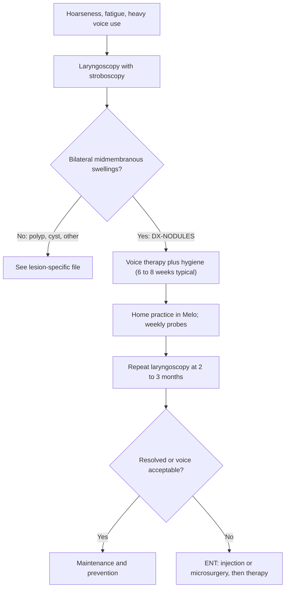

# Vocal fold nodules

## 1. Purpose and scope

This file profiles vocal fold nodules in adults for Melo and defines [DX-NODULES](#dx-nodules). It covers definition, prevalence (with Indian data), perceptual and acoustic profile, therapy evidence, medical and surgical context, time course, red flags, the need for laryngoscopy, and the limits of what home recordings can show. Paediatric nodules are out of scope because the app targets adults.

## 2. Summary table

| Item | Finding | Grade |
|---|---|---|
| Definition | Bilateral, benign, callus-like thickening of the mid-membranous folds, from phonotrauma [1][2] | **Strong** (consensus nomenclature) |
| Prevalence | 1.31% of Korean adults on population laryngoscopy [3]; 15% of a Belgian dysphonia clinic [4] | **Limited** (single studies) |
| Who | Mainly young women (18 to 39) [5] | **Limited** |
| Key acoustic shifts | Lower CPPS vowel, higher ABI, lower DSI [6]; F0 rises and jitter falls after therapy [7] | **Limited** to **Moderate** |
| First-line management | Voice therapy [8][9][10]; surgery for lesions that do not respond [8][11] | **Moderate** (no RCT of surgery vs therapy [11]) |
| Time course | Measurable improvement over 2 weeks to 2 months; size reduction may take up to 6 months [12][13][14] | **Limited** |
| Laryngoscopy | Needed to diagnose; nodules cannot be told from cysts, polyps or cancer by sound [8][1] | **Strong** |

## 3. Body

### DX-NODULES: Vocal fold nodules

**Definition.** Nodules are bilateral, usually symmetric, benign growths at the junction of the anterior and middle thirds of the membranous vocal folds. Histology shows epithelial thickening with variable inflammation in the superficial lamina propria [11]. A consensus nomenclature defines them by morphology, stroboscopy, response to voice therapy and intraoperative findings, and separates them from polyps, cysts, pseudocysts, fibrous masses and reactive lesions [2].

**Pathophysiology.** Nodules are attributed to phonotrauma: repeated high-impact collision of the folds during loud, frequent or effortful voice use [8]. In the vocal hyperfunction framework they are the classic phonotraumatic hyperfunction disorder [15] **Expert opinion**. Sex differences in phonatory frequency and the membranous fold's ability to withstand collision are the proposed reason they cluster in young women [5].

### Prevalence and demographics

| Population | Finding | Source |
|---|---|---|
| Korea, 19,636 adults with survey laryngoscopy (KNHANES 2008 to 2011) | Prevalence 1.31%; associated with age, education and voice disorder, not sex | [3] |
| Belgium, 882 treatment-seeking dysphonic patients (stroboscopy) | Nodules 15% (second after functional disorders, 30%); 15% also among professional voice users | [4] |
| US, 602 patients with benign lesions | Bilateral midfold lesions concentrated in women aged 18 to 39 | [5] |
| India, 50 surgically treated benign lesions (regional hospital) | Nodules 32% of lesions, polyps 56%; 70% male in this surgical series | [16] |
| India (JSS Mysore), hyperfunctional disorder from nodules, polyps or oedema | Higher harmonic amplitude differences (H1-H2, H1-A1 to H1-A3) than normal voices | [17] |
| India (PGIMER Chandigarh), 27 women aged 18 to 27 after a college festival | Incomplete closure, jitter and shimmer increased after heavy voice use | [18] |

No Indian population prevalence data for nodules found. Indian surgical series over-represent men and polyps [16], so they should not be read as the nodule sex ratio.

### Perceptual profile

Hoarseness, breathiness and vocal fatigue are typical [10]. In a case-control study of adult women, those with nodules more often had moderate breathiness [6]. GRBAS: raised G, B and R; CAPE-V: raised overall severity, breathiness and roughness ([M-GRBAS](../03-measures/perceptual-reference.md#m-grbas), [M-CAPEV](../03-measures/perceptual-reference.md#m-capev)).

### Acoustic profile

| Measure | Direction vs healthy | Evidence | Source |
|---|---|---|---|
| [M-CPPS-VOWEL](../03-measures/cepstral.md#m-cpps-vowel) | Lower | 19 women with nodules vs 21 controls, Praat | [6] |
| [M-CPPS-SPEECH](../03-measures/cepstral.md#m-cpps-speech) | Improves after treatment of benign lesions | 10-patient series | [19] |
| [M-ABI](../03-measures/composite-indices.md#m-abi) | Higher (more breathy) | Same case-control | [6] |
| [M-DSI](../03-measures/composite-indices.md#m-dsi) | Lower (worse) | Same case-control | [6] |
| [M-AVQI](../03-measures/composite-indices.md#m-avqi) | No significant group difference in that sample | Same case-control | [6] |
| [M-F0-MEAN](../03-measures/f0-pitch.md#m-f0-mean) | Rises after therapy by a pooled 33 Hz | Meta-analysis, 4 studies, 147 adults | [7] |
| [M-JITTER-LOCAL](../03-measures/perturbation.md#m-jitter-local) | Falls after therapy by a pooled 0.59 percentage points | Same meta-analysis | [7] |
| [M-SHIMMER-LOCAL](../03-measures/perturbation.md#m-shimmer-local) | Falls by 2.98 points, not significant (p = 0.052) | Same meta-analysis | [7] |
| [M-H1H2](../03-measures/spectral.md#m-h1h2) | Higher in hyperfunctional lesions (Indian sample) | Single group comparison | [17] |

### Why laryngoscopy is required before therapy

- AAO-HNS recommends laryngoscopy before voice therapy and whenever dysphonia persists beyond 4 weeks or a serious cause is suspected [1] **Strong**.
- The nomenclature that distinguishes nodules from cysts, pseudocysts and polyps rests on stroboscopy [2]. These lesions respond differently: cysts and fibrous masses respond less to therapy [2][20], so a misread lesion means months of ineffective practice.
- Nodules in men or older adults are atypical [5]; an apparent "nodule" outside the usual demographic needs imaging confirmation, and Indian series show a high share of malignancy among hoarse adults [21].

### Recommended therapy

| Program (exercise IDs) | Evidence | Grade |
|---|---|---|
| Comprehensive voice therapy (direct plus hygiene) | Systematic review of 21 studies: improved quality, reduced size, some resolution [9]; narrative review of 9 adult studies, low evidence levels [10] | **Moderate** |
| Resonant voice therapy ([EX-RVT-BTG](../01-exercises/resonant-voice-therapy.md#ex-rvt-btg), [EX-RVT-CHANT-SPEECH](../01-exercises/resonant-voice-therapy.md#ex-rvt-chant-speech), [EX-RVT-PHRASES](../01-exercises/resonant-voice-therapy.md#ex-rvt-phrases)) and confidential voice ([EX-CONF-VOICE](../01-exercises/confidential-voice.md#ex-conf-voice)) | 13 women, 2 weeks: benefit tracked compliance, not therapy type [12] | **Limited** |
| Accent method ([EX-ACCENT-LARGO](../01-exercises/accent-method.md#ex-accent-largo), [EX-ACCENT-ANDANTE](../01-exercises/accent-method.md#ex-accent-andante)) | RCT vs steroid injection, 50 women: therapy better at 3 months and for size at 6 months [13] | **Moderate** (single RCT) |
| Intensive vs traditional delivery | RCT, 53 women, 8 sessions either way: equivalent outcomes [22] | **Moderate** (single RCT) |
| Vocal hygiene education ([EX-HYG-HYDRATION](../01-exercises/vocal-hygiene.md#ex-hyg-hydration), [EX-HYG-VOICE-REST](../01-exercises/vocal-hygiene.md#ex-hyg-voice-rest), [EX-HYG-THROAT-CLEAR](../01-exercises/vocal-hygiene.md#ex-hyg-throat-clear)) | Multicentre RCT, 200 patients with polyps or nodules: reinforced education gave 61.3% resolution at 2 months vs 26.3% with standard education [14] | **Moderate** |
| SOVT ([EX-SOVT-STRAW](../01-exercises/sovt.md#ex-sovt-straw), [EX-SOVT-LIP-TRILL](../01-exercises/sovt.md#ex-sovt-lip-trill)), VFE ([EX-VFE-WARMUP](../01-exercises/vocal-function-exercises.md#ex-vfe-warmup), [EX-VFE-GLIDE-UP](../01-exercises/vocal-function-exercises.md#ex-vfe-glide-up)) | Included among direct techniques in the reviews [9][10]; no nodule-specific RCT found in this search | **Limited** |
| Conversation training therapy ([EX-CTT](../01-exercises/conversation-training-therapy.md#ex-ctt)) | Included benign lesions; non-randomised comparison [23] | **Limited** |

### Medical and surgical context

Voice therapy and microsurgical excision are the mainstays; intralesional steroid injection and angiolytic laser are accepted options [8]. A Cochrane review found no randomised trials comparing surgery with non-surgical treatment for nodules [11]. Steroid injection improves nodules quickly, but voice therapy gave better results by 3 to 6 months and appears to prevent recurrence better [13] **Moderate**. In a 224-patient lesion cohort treated with therapy first and surgery as needed, 67% eventually had surgery (all lesion types combined) and most finished with VHI-10 below 11 [20].

### Expected time course

| Study | Window | Result | Source |
|---|---|---|---|
| Resonant vs confidential voice, 13 women | About 2 weeks | Effort and perceptual gains, dependent on compliance | [12] |
| Reinforced hygiene RCT, 200 patients | 2 months | 61.3% lesion resolution | [14] |
| Accent method vs steroid RCT | 1 week to 6 months | Therapy ahead by month 3, size by month 6 | [13] |
| Intensive vs traditional RCT | 8 sessions | Equal gains | [22] |

A 4-week home program can plausibly show adherence and early within-patient change in CPPS, breathiness-sensitive measures and F0. Lesion resolution needs repeat laryngoscopy and typically 2 to 6 months [13][14]. Compliance with practice outside sessions predicted benefit [12], which supports adherence tracking as a primary app output.

### Red flags

[RF-PERSISTENT-HOARSENESS](../06-interpretation/red-flags.md#rf-persistent-hoarseness), [RF-SUDDEN-VOICE-LOSS](../06-interpretation/red-flags.md#rf-sudden-voice-loss) (possible haemorrhage after heavy use), [RF-PRACTICE-PAIN](../06-interpretation/red-flags.md#rf-practice-pain), [RF-ACOUSTIC-DECLINE](../06-interpretation/red-flags.md#rf-acoustic-decline), [RF-PROM-DECLINE](../06-interpretation/red-flags.md#rf-prom-decline).

### Care pathway

### Worked example

Input values are illustrative; expected change uses the pooled estimates in [7].

A 28-year-old female teacher with stroboscopy-confirmed nodules has a baseline mean F0 on /a/ of 190 Hz and local jitter of 1.40%. If she responds like the pooled adult sample, her post-therapy F0 would be about 223 Hz (95% CI 210 to 236 Hz) and her jitter about 0.81% (range 0.46 to 1.17%) [7]. Jitter is less reliable on phone recordings than CPPS (see [perturbation.md](../03-measures/perturbation.md)), so the app reports it as secondary. A rise in F0 is shown to the therapist as a change, not as "better": the meaning depends on her habitual pitch and the therapist's targets.

### What a 4-week home program can and cannot show

- Can show: adherence, practice consistency, within-patient change in CPPS, ABI or AVQI beyond personal measurement error, and self-reported effort and fatigue.
- Cannot show: whether the nodules have shrunk or resolved (needs laryngoscopy), whether surgery is needed, or long-term recurrence.

### What the app may conclude

- A therapist-entered nodules diagnosis exists, with the laryngoscopy date.
- Practice adherence and measured within-patient change since baseline.
- That a recording's quality was adequate for analysis.

### What the app must not conclude

- That nodules are present, shrinking or resolved.
- That a breathy or rough voice means nodules rather than a cyst, polyp, paresis or cancer.
- That surgery is or is not needed.

## 4. Conflicting evidence

- **Short vs long therapy.** A narrative review suggested short treatments (under 3 weeks) may match longer programs [10], but the same review graded the evidence as low and called for better data. An RCT found equal outcomes for intensive and traditional schedules with the same session count [22].
- **Steroid injection vs therapy.** Injection acts faster, therapy lasts longer [13]; only one RCT addresses this.
- **AVQI.** AVQI did not separate women with nodules from controls in one study [6], while ABI and DSI did. The disorder profile therefore lists ABI alongside AVQI.

## 5. Gaps and open questions

- No Indian prevalence data or Indian acoustic norms for nodules found.
- No RCT of surgery vs therapy [11].
- Smartphone-recorded change thresholds for nodules are Not established. A test-retest study in 30 or more adults with nodules, recording twice within a week before therapy on study phones, would establish MDC values.
- Home-only practice without clinician sessions is untested for nodules.

## 6. Implementation in Melo

- **Feature and layer.** `DiagnosisCode.nodules` in `lib/features/study/domain/diagnosis.dart` (see [README.md](README.md#shared-implementation-contract)).
- **Measure emphasis.** Primary: [M-CPPS-VOWEL](../03-measures/cepstral.md#m-cpps-vowel), [M-CPPS-SPEECH](../03-measures/cepstral.md#m-cpps-speech), [M-ABI](../03-measures/composite-indices.md#m-abi), [M-AVQI](../03-measures/composite-indices.md#m-avqi). Secondary: [M-F0-MEAN](../03-measures/f0-pitch.md#m-f0-mean) (shown as change, no direction label), [M-JITTER-LOCAL](../03-measures/perturbation.md#m-jitter-local). Add vocal fatigue self-report ([PROM-VFI](../06-interpretation/proms.md#prom-vfi)).
- **Existing classes.** `ExerciseTargets` needs a `loudnessBand` (research doc 7.4) because hygiene and confidential voice target reduced loudness; `Recording` should carry a self-reported voice-use context (heavy voice day yes or no) so a post-teaching probe is not read as decline (see [ENV-VOICE-USE](../04-sensors-environment/env-physiological.md#env-voice-use)).
- **New interface.** `bool directionLabelled(String measureId, DiagnosisCode code)` in `disorder_profiles.dart` returns false for F0 in nodules so the UI shows change without "improved".
- **On-device vs offline.** Profile rules on device; analysis per `../07-signal-processing/`.
- **Data file.** Feeds `status-rules.yaml` (Agent 6) via the disorder-specific primary measure list; no YAML owned here.

## 7. References

1. [AAOHNS2018] Stachler RJ, Francis DO, Schwartz SR, et al. 2018. Clinical Practice Guideline: Hoarseness (Dysphonia) (Update). Otolaryngol Head Neck Surg 158(1_suppl):S1-S42. doi:10.1177/0194599817751030. PMID 29494321.
2. [Rosen2012] Rosen CA, Gartner-Schmidt J, Hathaway B, et al. 2012. A nomenclature paradigm for benign midmembranous vocal fold lesions. Laryngoscope 122(6):1335-1341. doi:10.1002/lary.22421. PMID 22522621.
3. [Won2016] Won SJ, Kim RB, Kim JP, et al. 2016. The prevalence and factors associate with vocal nodules in general population: Cross-sectional epidemiological study. Medicine (Baltimore) 95(39):e4971. doi:10.1097/MD.0000000000004971. PMID 27684845.
4. [VanHoutte2010] Van Houtte E, Van Lierde K, D'Haeseleer E, et al. 2010. The prevalence of laryngeal pathology in a treatment-seeking population with dysphonia. Laryngoscope 120(2):306-312. doi:10.1002/lary.20696. PMID 19957345.
5. [Zhukhovitskaya2015] Zhukhovitskaya A, Battaglia D, Khosla SM, et al. 2015. Gender and age in benign vocal fold lesions. Laryngoscope 125(1):191-196. doi:10.1002/lary.24911. PMID 25216037.
6. [Meinberg2026] Meinberg LPD, Penido FA, de Oliveira KVG, et al. 2026. Women with Vocal Fold Nodules: Analysis of Voice Quality and Vocal Self-Perception. J Voice (online ahead of print). doi:10.1016/j.jvoice.2026.03.009. PMID 42097916.
7. [Alegria2020a] Alegria R, Freitas SV, Manso MC. 2020. Is there an improvement on acoustic voice parameters in patients with bilateral vocal fold nodules after voice therapy? A meta-analysis. Eur Arch Otorhinolaryngol 277(8):2163-2172. doi:10.1007/s00405-020-05956-2. PMID 32296978.
8. [Naunheim2017] Naunheim MR, Carroll TL. 2017. Benign vocal fold lesions: update on nomenclature, cause, diagnosis, and treatment. Curr Opin Otolaryngol Head Neck Surg 25(6):453-458. doi:10.1097/MOO.0000000000000408. PMID 29099730.
9. [Mansuri2018] Mansuri B, Tohidast SA, Soltaninejad N, et al. 2018. Nonmedical Treatments of Vocal Fold Nodules: A Systematic Review. J Voice 32(5):609-620. doi:10.1016/j.jvoice.2017.08.023. PMID 29032130.
10. [Alegria2020b] Alegria R, Vaz Freitas S, Manso MC. 2020. Effectiveness of voice therapy in patients with vocal fold nodules: a systematic search and narrative review. Eur Arch Otorhinolaryngol 277(11):2951-2966. doi:10.1007/s00405-020-06059-8. PMID 32444967.
11. [Pedersen2012] Pedersen M, McGlashan J. 2012. Surgical versus non-surgical interventions for vocal cord nodules. Cochrane Database Syst Rev (6):CD001934. doi:10.1002/14651858.CD001934.pub2. PMID 22696326.
12. [VerdoliniMarston1995] Verdolini-Marston K, Burke MK, Lessac A, et al. 1995. Preliminary study of two methods of treatment for laryngeal nodules. J Voice 9(1):74-85. doi:10.1016/s0892-1997(05)80225-5. PMID 7757153.
13. [Hassan2026] Hassan ES, Kamel NA, Mohamed HA. 2026. Intralesional steroid injection versus voice therapy for the management of early vocal fold nodules in female patients: a randomized controlled trial. Eur Arch Otorhinolaryngol 283(2):955-967. doi:10.1007/s00405-025-09923-7. PMID 41466070.
14. [Hosoya2018] Hosoya M, Kobayashi R, Ishii T, et al. 2018. Vocal Hygiene Education Program Reduces Surgical Interventions for Benign Vocal Fold Lesions: A Randomized Controlled Trial. Laryngoscope 128(11):2593-2599. doi:10.1002/lary.27415. PMID 30079962.
15. [Hillman2020] Hillman RE, Stepp CE, Van Stan JH, et al. 2020. An Updated Theoretical Framework for Vocal Hyperfunction. Am J Speech Lang Pathol 29(4):2254-2260. doi:10.1044/2020_AJSLP-20-00104. PMID 33007164.
16. [Malik2019] Malik P, Yadav SPS, Sen R, et al. 2019. The Clinicopathological Study of Benign Lesions of Vocal Cords. Indian J Otolaryngol Head Neck Surg 71(Suppl 1):212-220. doi:10.1007/s12070-017-1240-0. PMID 31741962.
17. [Narasimhan2017] Narasimhan SV, Vishal K. 2017. Spectral Measures of Hoarseness in Persons with Hyperfunctional Voice Disorder. J Voice 31(1):57-61. doi:10.1016/j.jvoice.2016.03.005. PMID 27080591.
18. [Sharma2022] Sharma A, Sharma H, Munjal S, et al. 2022. Acoustic, Perceptual, and Laryngoscopic Changes Post Vocal Abuse at a College Fest. J Voice 36(5):690-694. doi:10.1016/j.jvoice.2020.07.029. PMID 32828597.
19. [Gillespie2014] Gillespie AI, Dastolfo C, Magid N, et al. 2014. Acoustic analysis of four common voice diagnoses: moving toward disorder-specific assessment. J Voice 28(5):582-588. doi:10.1016/j.jvoice.2014.02.002. PMID 24880672.
20. [Akbulut2016] Akbulut S, Gartner-Schmidt JL, Gillespie AI, et al. 2016. Voice outcomes following treatment of benign midmembranous vocal fold lesions using a nomenclature paradigm. Laryngoscope 126(2):415-420. doi:10.1002/lary.25488. PMID 26404117.
21. [Vivek2022] Vivek S, Shankar G. 2022. Changing Trend in the Etiological Spectrum of Hoarseness of Voice in Rural India: A Prospective Hospital-Based Study. Indian J Otolaryngol Head Neck Surg 74(Suppl 2):1896-1901. doi:10.1007/s12070-020-01902-0. PMID 36452701.
22. [Fu2015] Fu S, Theodoros DG, Ward EC. 2015. Intensive versus traditional voice therapy for vocal nodules: perceptual, physiological, acoustic and aerodynamic changes. J Voice 29(2):260.e31-260.e44. doi:10.1016/j.jvoice.2014.06.005. PMID 25311594.
23. [Gillespie2019] Gillespie AI, Yabes J, Rosen CA, et al. 2019. Efficacy of Conversation Training Therapy for Patients With Benign Vocal Fold Lesions and Muscle Tension Dysphonia Compared to Historical Matched Control Patients. J Speech Lang Hear Res 62(11):4062-4079. doi:10.1044/2019_JSLHR-S-19-0136. PMID 31619107.

## 8. Last searched

2026-10-09. PubMed (NCBI E-utilities); Europe PMC attempted (HTTP 503) and replaced by PubMed affiliation searches; Cochrane Library via PubMed (CD001934).
