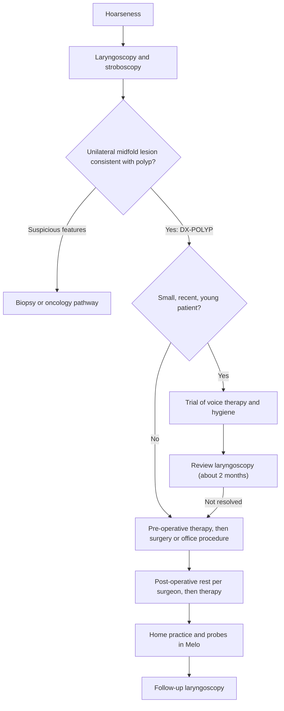

# Vocal fold polyps

## 1. Purpose and scope

This file profiles vocal fold polyps in adults and defines [DX-POLYP](#dx-polyp). Polyps differ from nodules in two ways that matter for the app: they are usually unilateral and more often need surgery, so many Melo patients with polyps will be practising before or after phonosurgery. Post-operative care beyond polyps is in [post-surgical-voice.md](post-surgical-voice.md#dx-postsurg).

## 2. Summary table

| Item | Finding | Grade |
|---|---|---|
| Definition | Usually unilateral benign midmembranous lesion, sessile or pedunculated, sometimes haemorrhagic [1][2] | **Strong** (consensus nomenclature) |
| Who | Predominantly men in a US lesion series [3]; most common surgically treated benign lesion in an Indian series (56%) [4] | **Limited** |
| Contributors | Phonotrauma, reflux, smoking [2]; pH-confirmed reflux OR 3.26 for benign lesions [5] | **Moderate** |
| Key acoustic shifts | Higher jitter, shimmer and noise; improve after surgery [6] | **Limited** |
| Management | Surgery and combined treatment give the largest gains; therapy alone helps smaller, recent polyps [7][8] | **Moderate** |
| Post-op therapy | 9 RCTs, 730 patients: lower VHI, better jitter, shimmer, DSI and MPT [9] | **Moderate** |
| Recurrence | 13.0% overall after surgery; 7.14% with adjunct therapy vs 24.44% without [10] | **Limited** |
| Laryngoscopy | Required to diagnose and to separate from cysts and cancer [11][1] | **Strong** |

## 3. Body

### DX-POLYP: Vocal fold polyp

**Definition.** A benign exophytic lesion of the midmembranous vocal fold, typically unilateral, defined in the consensus nomenclature by its morphology, stroboscopic behaviour, response to therapy and intraoperative findings [1]. A contralateral reactive lesion may form opposite it [1].

**Pathophysiology.** A scoping review of 59 papers attributes polyps mainly to phonotrauma, with reflux and smoking as contributors [2]. A meta-analysis of studies using pharyngeal pH monitoring found reflux associated with higher odds of benign lesions, including polyps (OR 3.26, 95% CI 1.84 to 5.76) [5] **Moderate** (observational).

### Prevalence and demographics

| Population | Finding | Source |
|---|---|---|
| US, 641 lesions in 602 adults | Polyps found predominantly in men (p < 0.0001) | [3] |
| Turkey, 211 polyp patients treated at a tertiary centre | 108 men, 103 women, mean age 41.3 years | [8] |
| Systematic review of recurrence, 1,101 lesions | Polyps were 53.7% of surgically treated lesions | [10] |
| India, 50 benign lesions treated surgically (regional hospital) | Polyps 56%, the most common; 70% male; peak age 20 to 29 | [4] |
| India (Bhopal), 45 dysphonic patients with stroboscopy | Polyp was the second commonest diagnosis (7 cases) after malignancy (13) | [12] |
| India (JSS Mysore), hyperfunctional disorders including polyps | Higher H1-H2 and H1-A1 to H1-A3 than normal speakers | [13] |

No Indian population prevalence for polyps found; Indian data come from hospital series.

### Perceptual profile

Polyp outcome studies rate grade, roughness and breathiness (GRB) [8][14]; these scores fall after surgery, pre-surgical therapy and in-office laser [8][14]. Expected GRBAS pattern: raised G, R and B ([M-GRBAS](../03-measures/perceptual-reference.md#m-grbas)).

### Acoustic profile

| Measure | Direction vs healthy | Evidence | Source |
|---|---|---|---|
| [M-JITTER-LOCAL](../03-measures/perturbation.md#m-jitter-local), [M-SHIMMER-LOCAL](../03-measures/perturbation.md#m-shimmer-local) | Higher; fall after surgery and after post-op therapy (SMD -1.16 and -1.18) | 46 women pre and post surgery; meta-analysis of 9 RCTs | [6][9] |
| [M-HNR](../03-measures/noise.md#m-hnr) / noise-to-harmonics | More noise; improves after surgery | Same case series | [6] |
| [M-F0-SD](../03-measures/f0-pitch.md#m-f0-sd) | F0 variation higher | Same case series | [6] |
| [M-DSI](../03-measures/composite-indices.md#m-dsi) | Improves after post-op therapy (SMD 1.53) | Meta-analysis of RCTs | [9] |
| [M-MPT](../03-measures/temporal.md#m-mpt) | Shorter; lengthens after post-op therapy (SMD 0.65), steroid injection (+1.82 s) and office laser | Meta-analyses | [9][15][14] |
| [M-CPPS-SPEECH](../03-measures/cepstral.md#m-cpps-speech) | Improves after treatment of benign lesions | 10-patient series | [16] |
| [M-H1H2](../03-measures/spectral.md#m-h1h2) | Higher in hyperfunctional lesions (Indian sample) | Group comparison | [13] |

### Why laryngoscopy is required before therapy

AAO-HNS recommends laryngoscopy before voice therapy and advocates surgery for symptomatic benign lesions that fail conservative care and for suspected malignancy [11] **Strong**. A unilateral mass cannot be distinguished from a cyst, papilloma, granuloma or carcinoma by voice: the nomenclature relies on stroboscopy and sometimes intraoperative findings [1]. In Indian ENT series malignancy appears among the commonest causes of hoarseness [12][17], and polyps share risk factors (male sex, smoking) with laryngeal cancer.

### Recommended therapy

| Program (exercise IDs) | Evidence | Grade |
|---|---|---|
| Phonosurgery plus voice therapy (combined) | Meta-analysis of 31 studies: all approaches had large effects; surgery and combined treatment gave the largest improvements [7] | **Moderate** |
| Pre-surgical voice therapy | Retrospective, 211 patients: therapy before surgery gave the best final outcomes; therapy alone was less effective than surgery but can suffice for young patients, small polyps and short duration [8] | **Limited** |
| Post-operative voice therapy (resonant voice, SOVT, VFE; see [EX-RVT-BTG](../01-exercises/resonant-voice-therapy.md#ex-rvt-btg), [EX-SOVT-STRAW](../01-exercises/sovt.md#ex-sovt-straw), [EX-VFE-WARMUP](../01-exercises/vocal-function-exercises.md#ex-vfe-warmup)) | 9 RCTs (730 patients): VHI mean difference -9.66 and better acoustics and MPT, with high heterogeneity [9]; adjunct therapy linked to lower recurrence [10] | **Moderate** |
| Vocal hygiene ([EX-HYG-HYDRATION](../01-exercises/vocal-hygiene.md#ex-hyg-hydration), [EX-HYG-IRRITANTS](../01-exercises/vocal-hygiene.md#ex-hyg-irritants), [EX-HYG-THROAT-CLEAR](../01-exercises/vocal-hygiene.md#ex-hyg-throat-clear)) | Reinforced hygiene education RCT in polyps and nodules: 61.3% resolution at 2 months vs 26.3% [18] | **Moderate** |
| Conversation training therapy ([EX-CTT](../01-exercises/conversation-training-therapy.md#ex-ctt)) | Benign lesions included; non-randomised [19] | **Limited** |

Exercise choice is the SLP's. The exercise files list contraindications (for example, the early post-operative window; see [post-surgical-voice.md](post-surgical-voice.md#dx-postsurg)).

### Medical and surgical context

- **Phonomicrosurgery** is the definitive treatment [2]; in a 224-patient cohort of benign lesions, polyps showed among the largest VHI-10 changes after treatment [20].
- **In-office options.** Office-based laser for polyps improved VHI-10, GRB, shimmer and MPT in a meta-analysis of 10 observational studies (242 patients) [14]. Intralesional steroid injection for benign lesions increased MPT by 1.82 s and reduced VHI by 27.61 points, with recurrence 4 to 31% [15].
- **Voice rest.** A small RCT found 3 days of rest followed by therapy better than 7 days [21]; a Swedish register of 588 polyp operations found no advantage of total voice rest [22]. Rest instructions are the surgeon's.
- **Reflux.** Treated per the ENT's assessment; the guideline advises against antireflux medication for dysphonia without laryngoscopy [11].

### Expected time course

| Context | Window | Source |
|---|---|---|
| Acoustic improvement after microsurgery | Measurable at 3 weeks | [6] |
| Reinforced hygiene education | 61.3% resolution at 2 months | [18] |
| Voice rest then therapy | Differences at 1, 3 and 6 months | [21] |
| Patient-reported outcome after surgery | Assessed at 4 months | [22] |

A 4-week home program before surgery can show adherence and modest acoustic change; resolution of the polyp itself needs laryngoscopy and often surgery [7][8]. After surgery, 4 weeks covers the early recovery window in which acoustic measures improve [6], but healing must be judged by the surgeon.

### Red flags

[RF-SUDDEN-VOICE-LOSS](../06-interpretation/red-flags.md#rf-sudden-voice-loss) (possible haemorrhage), [RF-PERSISTENT-HOARSENESS](../06-interpretation/red-flags.md#rf-persistent-hoarseness) (especially in smokers), [RF-POSTSURG-WORSENING](../06-interpretation/red-flags.md#rf-postsurg-worsening), [RF-STRIDOR](../06-interpretation/red-flags.md#rf-stridor) (large lesions), [RF-HEMOPTYSIS](../06-interpretation/red-flags.md#rf-hemoptysis), [RF-PRACTICE-PAIN](../06-interpretation/red-flags.md#rf-practice-pain).

### Care pathway

### Worked example

Inputs are illustrative; the expected change is from [15].

A 45-year-old man with a polyp has three baseline maximum phonation time trials of 9.0, 10.5 and 12.0 s (mean 10.5 s, SD 1.5 s). His personal MDC95 (research doc section 6 formula) is 1.96 x sqrt(2) x 1.5 = 4.16 s. After an in-office steroid injection, the meta-analytic mean MPT gain is 1.82 s (95% CI 0.29 to 3.35) [15]. An average responder would move from 10.5 to about 12.3 s: a real group-level gain that stays inside his MDC95, so the engine reports "Stable". This shows two things: MPT is too variable within a person to detect typical treatment effects without tighter trial-to-trial consistency, and the research doc's provisional 2.0 s MPT floor is close to the average treatment effect itself, so that floor cannot be justified from this evidence.

### What a 4-week home program can and cannot show

- Can show: adherence to pre- or post-operative exercises, within-patient change in CPPS and MPT, self-reported voice handicap.
- Cannot show: whether the polyp has shrunk, whether surgery is needed, whether a post-operative fold has healed, or recurrence.

### What the app may conclude

- A therapist-entered polyp diagnosis and, if relevant, the surgery date are on file.
- Adherence and measured change since the relevant baseline (pre- or post-operative).

### What the app must not conclude

- That a polyp is present, growing, shrinking or recurring.
- That surgery is or is not needed, or that it is safe to stop voice rest.
- That a sudden worsening is "just a bad day": sudden loss after surgery or heavy use is escalated.

## 4. Conflicting evidence

- **Therapy alone vs surgery.** A meta-analysis found all approaches highly effective [7], while a retrospective series found therapy alone clearly inferior to surgery [8]. Selection explains part of this: therapy-alone groups often had smaller, newer polyps [8].
- **Voice rest.** A small RCT favoured 3 over 7 days of rest [21]; a large register found no benefit of total rest on satisfaction at 4 months [22].

## 5. Gaps and open questions

- No Indian population or acoustic-norm data for polyps; Indian surgical series only.
- Polyp-specific smartphone MDC and MCID values are Not established. A pre-operative test-retest study and a 3-month post-operative follow-up on study phones would establish them.
- Which polyps respond to therapy alone is supported only by retrospective data [8]; a prospective cohort with lesion size measured on stroboscopy would settle it.

## 6. Implementation in Melo

- **Feature and layer.** `DiagnosisCode.polyp` in `lib/features/study/domain/diagnosis.dart` (see [README.md](README.md#shared-implementation-contract)).
- **New field.** `PatientDiagnosis.procedureOn` (`DateTime?`), entered by the therapist, so baselines can be split into pre- and post-operative epochs. `ProbeDue.compute` should restart the baseline after a procedure date rather than compare across it.
- **Measure emphasis.** Primary: [M-CPPS-VOWEL](../03-measures/cepstral.md#m-cpps-vowel), [M-CPPS-SPEECH](../03-measures/cepstral.md#m-cpps-speech), [M-AVQI](../03-measures/composite-indices.md#m-avqi). Secondary: [M-MPT](../03-measures/temporal.md#m-mpt), [M-SHIMMER-LOCAL](../03-measures/perturbation.md#m-shimmer-local).
- **Interface.** `DateTime baselineEpochStart(PatientDiagnosis diagnosis, DateTime enrolledOn)` in `disorder_profiles.dart`.
- **On-device vs offline.** Pure rules on device.
- **Data file.** Feeds `status-rules.yaml` (Agent 6) and the post-operative red flag in `red-flags.yaml`; no YAML owned here.

## 7. References

1. [Rosen2012] Rosen CA, Gartner-Schmidt J, Hathaway B, et al. 2012. A nomenclature paradigm for benign midmembranous vocal fold lesions. Laryngoscope 122(6):1335-1341. doi:10.1002/lary.22421. PMID 22522621.
2. [Kenny2025] Kenny HL, Friedman L, Blake Simpson C, et al. 2025. Vocal Fold Polyps: A Scoping Review. J Voice 39(6):1622-1630. doi:10.1016/j.jvoice.2023.06.007. PMID 37433709.
3. [Zhukhovitskaya2015] Zhukhovitskaya A, Battaglia D, Khosla SM, et al. 2015. Gender and age in benign vocal fold lesions. Laryngoscope 125(1):191-196. doi:10.1002/lary.24911. PMID 25216037.
4. [Malik2019] Malik P, Yadav SPS, Sen R, et al. 2019. The Clinicopathological Study of Benign Lesions of Vocal Cords. Indian J Otolaryngol Head Neck Surg 71(Suppl 1):212-220. doi:10.1007/s12070-017-1240-0. PMID 31741962.
5. [Ren2024] Ren QW, Lei G, Zhao YL, et al. 2024. Laryngopharyngeal Reflux and Benign Vocal Fold Lesions: A Systematic Review and Meta-analysis. Otolaryngol Head Neck Surg 170(2):309-319. doi:10.1002/ohn.529. PMID 37727944.
6. [PetrovicLazic2011] Petrović-Lazić M, Babac S, Vuković M, et al. 2011. Acoustic voice analysis of patients with vocal fold polyp. J Voice 25(1):94-97. doi:10.1016/j.jvoice.2009.04.002. PMID 20083380.
7. [BarstiesVLatoszek2023] Barsties v Latoszek B, Watts CR, Hetjens S, et al. 2023. The Efficacy of Different Voice Treatments for Vocal Fold Polyps: A Systematic Review and Meta-Analysis. J Clin Med 12(10):3451. doi:10.3390/jcm12103451. PMID 37240557.
8. [Sahin2018] Sahin M, Gode S, Dogan M, et al. 2018. Effect of voice therapy on vocal fold polyp treatment. Eur Arch Otorhinolaryngol 275(6):1533-1540. doi:10.1007/s00405-018-4962-z. PMID 29626250.
9. [Yang2026] Yang K, You Q, Huang S, et al. 2026. Results of postoperative voice therapy for vocal cord polyps: systematic review and meta-analysis. Eur Arch Otorhinolaryngol 283(6):3513-3526. doi:10.1007/s00405-026-10017-1. PMID 41680504.
10. [Gocal2025] Gocal WA, Tong JY, Maxwell PJ, et al. 2025. Systematic Review of Recurrence Rates of Benign Vocal Fold Lesions Following Surgery. J Voice 39(3):787-798. doi:10.1016/j.jvoice.2022.10.015. PMID 36513559.
11. [AAOHNS2018] Stachler RJ, Francis DO, Schwartz SR, et al. 2018. Clinical Practice Guideline: Hoarseness (Dysphonia) (Update). Otolaryngol Head Neck Surg 158(1_suppl):S1-S42. doi:10.1177/0194599817751030. PMID 29494321.
12. [Chavan2022] Chavan A, Maran R, Chavan G. 2022. Dysphonia: Epidemiology, Diagnosis and Risk Factors at Tertiary Health Care Center. Indian J Otolaryngol Head Neck Surg 74(Suppl 3):5611-5615. doi:10.1007/s12070-021-02952-8. PMID 36742701.
13. [Narasimhan2017] Narasimhan SV, Vishal K. 2017. Spectral Measures of Hoarseness in Persons with Hyperfunctional Voice Disorder. J Voice 31(1):57-61. doi:10.1016/j.jvoice.2016.03.005. PMID 27080591.
14. [AbiZeidDaou2025] Abi Zeid Daou C, Ghanem A, Hosri J, et al. 2025. Office-Based Laser Therapy in Vocal Fold Polyps: A Systematic Review and Meta-Analysis. J Voice 39(5):1357-1367. doi:10.1016/j.jvoice.2023.03.003. PMID 37003865.
15. [Wang2013] Wang CT, Liao LJ, Cheng PW, et al. 2013. Intralesional steroid injection for benign vocal fold disorders: a systematic review and meta-analysis. Laryngoscope 123(1):197-203. doi:10.1002/lary.23551. PMID 22965481.
16. [Gillespie2014] Gillespie AI, Dastolfo C, Magid N, et al. 2014. Acoustic analysis of four common voice diagnoses: moving toward disorder-specific assessment. J Voice 28(5):582-588. doi:10.1016/j.jvoice.2014.02.002. PMID 24880672.
17. [Vivek2022] Vivek S, Shankar G. 2022. Changing Trend in the Etiological Spectrum of Hoarseness of Voice in Rural India: A Prospective Hospital-Based Study. Indian J Otolaryngol Head Neck Surg 74(Suppl 2):1896-1901. doi:10.1007/s12070-020-01902-0. PMID 36452701.
18. [Hosoya2018] Hosoya M, Kobayashi R, Ishii T, et al. 2018. Vocal Hygiene Education Program Reduces Surgical Interventions for Benign Vocal Fold Lesions: A Randomized Controlled Trial. Laryngoscope 128(11):2593-2599. doi:10.1002/lary.27415. PMID 30079962.
19. [Gillespie2019] Gillespie AI, Yabes J, Rosen CA, et al. 2019. Efficacy of Conversation Training Therapy for Patients With Benign Vocal Fold Lesions and Muscle Tension Dysphonia Compared to Historical Matched Control Patients. J Speech Lang Hear Res 62(11):4062-4079. doi:10.1044/2019_JSLHR-S-19-0136. PMID 31619107.
20. [Akbulut2016] Akbulut S, Gartner-Schmidt JL, Gillespie AI, et al. 2016. Voice outcomes following treatment of benign midmembranous vocal fold lesions using a nomenclature paradigm. Laryngoscope 126(2):415-420. doi:10.1002/lary.25488. PMID 26404117.
21. [Kaneko2017] Kaneko M, Shiromoto O, Fujiu-Kurachi M, et al. 2017. Optimal Duration for Voice Rest After Vocal Fold Surgery: Randomized Controlled Clinical Study. J Voice 31(1):97-103. doi:10.1016/j.jvoice.2016.02.009. PMID 27492336.
22. [Bjorck2022] Björck G, Hertegård S, Ekelund J, et al. 2022. Voice rest after vocal fold polyp surgery: A Swedish register study of 588 patients. Laryngoscope Investig Otolaryngol 7(2):486-493. doi:10.1002/lio2.775. PMID 35434318.

## 8. Last searched

2026-10-09. PubMed (NCBI E-utilities).
