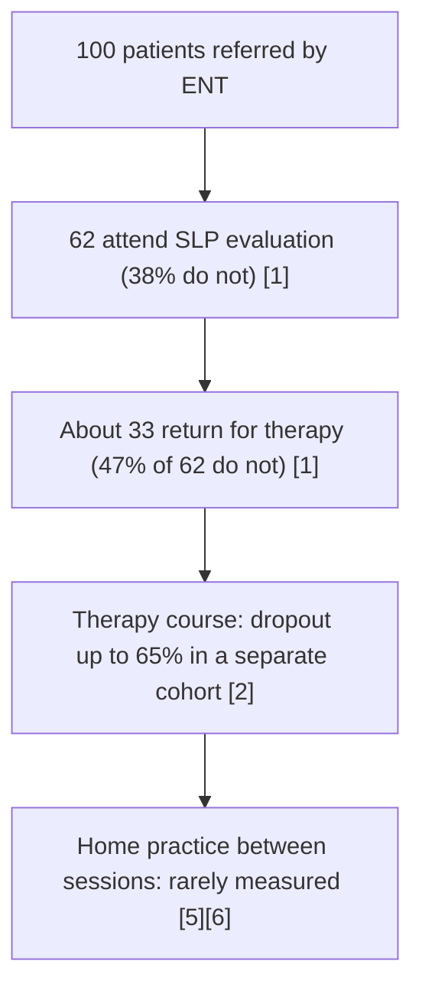

# Adherence rates and barriers in voice therapy

## 1. Purpose and scope

This file summarizes how often voice therapy patients attend, drop out of, and practise during behavioural voice therapy, and which factors help or hinder them. It adds comparison data from home physiotherapy, Parkinson's disease rehabilitation and an Indian home swallowing exercise programme, because voice-specific home practice data are scarce. It informs how Melo interprets the adherence it records, which barriers it could capture, and what a 4-week pilot at an Indian institution should expect.

Out of scope: definitions and measurement of adherence versus compliance ([adherence-vs-compliance.md](adherence-vs-compliance.md)), the effect of app features on engagement ([mhealth-engagement-evidence.md](mhealth-engagement-evidence.md)), and behaviour change technique mapping ([bct-mapping.md](bct-mapping.md)).

## 2. Summary table

| Question | Best available answer | Population behind it | Grade |
|---|---|---|---|
| How many referred patients never start voice therapy? | 38% did not attend after ENT referral [1] | 294 charts, 2 US voice centres | **Limited** |
| How many drop out after starting? | 47% did not return after evaluation [1]; 65% dropped out over the course [2]; reviews report 30% to 65% [4] | US, Israeli and mixed cohorts | **Moderate** |
| How is adherence measured in voice studies? | Mostly therapy completion or attendance; home practice rarely measured; definitions rarely given [4][5][6] | Two scoping reviews, one systematic review | **Moderate** |
| Do demographics or severity predict dropout? | Generally no [2][5][8] | US and Israeli cohorts | **Limited** |
| What does predict it? | Wait time and sessions attended [3]; self-efficacy and therapeutic alliance [11] | US cohorts and one RCT | **Limited** |
| Can technology raise home practice? | Video and app support raised self-reported practice frequency in small trials [10][11][12][13][14] | US, n = 11 to 40 | **Limited** |
| Comparable home-exercise non-adherence | Up to 70% in home physiotherapy [16]; Indian self-directed swallowing exercises 61.6% adherence vs 87.7% clinician-directed [19] | UK review; South Indian RCT | **Moderate** (physio), **Limited** (India) |
| Indian voice therapy attendance or dropout rate | Not established. Only qualitative barrier data exist [20][21] | Chennai school teachers | **Limited** |

## 3. Attendance and dropout

### 3.1 Rates reported in voice therapy

| Study | Design and population | Finding |
|---|---|---|
| Portone 2008 [1] | Retrospective, 294 charts, 2 voice centres, Atlanta, USA | 38% did not attend after referral; 47% of those evaluated did not return. No difference by sex or age group. Main reasons: insurance denial, problem resolved, distance. |
| Hapner 2009 [2] | Retrospective, 2 US voice centres | 65% dropout over the therapy course. Sex, age, race, VHI, CAPE-V severity and diagnosis did not predict dropout. |
| Portone-Maira 2011 [3] | Retrospective, 197 cases (120 dropouts, 77 completers), ages 15 to 90, USA | Number of sessions attended and wait time from referral to evaluation were the strongest predictors of completion. |
| Marsha 2026 [8] | Retrospective, 137 adults, Israel | Overall non-adherence 74.4%; median 3 visits. Each additional visit raised odds of improvement (OR 2.58). Cultural minority status did not change adherence rate. |
| Cutchin 2023 [9] | Retrospective, 157 in-person (2019) vs 176 telepractice (2020) patients, Emory, USA | Telepractice year had higher initiation and attendance and fewer missed appointments. |
| Stewart 2026 [4] | Scoping review to January 2026 | Dropout about 30% to 65% across included studies; adherence mostly operationalized as attendance or completion. |

The dropout range is wide but consistently high (**Moderate**: one systematic review [6] and two scoping reviews [4][5] agree that adherence is low, built on retrospective cohorts).

### 3.2 Referral-to-therapy funnel

The two Portone and Hapner cohorts come from the same centres but different samples, so the arithmetic below is illustrative only.



Worked example: 100 referred, 38 do not attend, leaving 62. Of these, 0.47 x 62 = 29.1, so about 29 do not return and about 33 start therapy. Applying the Hapner dropout figure to those 33 would leave about 12 completers (0.35 x 33 = 11.6), but this chains rates from different samples and is not a measured cascade.

### 3.3 Why dropout matters for the app

Session count is linked to outcome [8], and completers improve more on VHI and acoustic measures than non-completers [22]. A home practice app does not change clinic attendance directly, but telepractice data suggest that lowering travel and scheduling costs raises attendance [9]. Distance and travel recur as barriers in both US [1] and Indian [20] data.

## 4. Home practice adherence

Home practice between sessions is the behaviour Melo records, and it is the least measured part of voice therapy adherence [5][6].

| Study | Design | Home practice finding |
|---|---|---|
| van Leer and Connor 2010 [7] | Qualitative interviews, 15 patients | Themes: therapy is hard; patients must make practice happen; the clinician match matters. |
| van Leer and Connor 2012 [10] | Randomized crossover, 13 patients, 1 week per condition | Clinician and self-model videos on portable players raised self-reported practice and commitment, importance and confidence compared with written homework. |
| van Leer and Connor 2015 [11] | RCT, 40 adults with adducted hyperfunction, 4 sessions | Self-efficacy and therapeutic alliance predicted adherence (self-efficacy explained about 29% of variance). MP4 video raised generalization (74.8% vs 58.4%) and helped most those with low baseline self-efficacy. Adherence was self-reported. |
| van Leer 2021 [12] | RCT, 34 adults with adducted hyperfunction, 3 weeks resonant voice | App with reminders, instruction recordings and CPP feedback raised practice frequency; motivation and self-reported generalization unchanged. Practice predicted by System Usability Scale score. CPP feedback useful to only a subset. |
| Angadi 2023 [13] | Single-blind RCT, normophonic adults, app n = 12 vs written n = 13 | App group missed about 50% fewer home practice tasks (p = 0.04); dropout similar. |
| van Leer 2026 [14] | Randomized crossover, 11 patients, conversation training therapy | App raised practice frequency, practice fidelity and goal commitment. |
| Huss 2026 [15] | Qualitative, 12 Swedish app users | App experienced as structure and a reminder of correct technique; users asked for recording and feedback functions. |

Findings are consistent in direction but all trials are small, short (1 to 4 weeks) and rely on self-report (**Limited**). The only trial with objective practice data recorded all home practice as audio [12]. Effects on [EX-CTT](../01-exercises/conversation-training-therapy.md#ex-ctt) and resonant voice tasks such as [EX-RVT-BTG](../01-exercises/resonant-voice-therapy.md#ex-rvt-btg) come from different trials and cannot be pooled.

## 5. Barriers and facilitators

### 5.1 Factor table

| Factor | Direction | Evidence | Grade |
|---|---|---|---|
| Self-efficacy (confidence to practise) | Higher predicts adherence | Voice RCT [11]; home physiotherapy SR [16] | **Moderate** (cross-field concordance) |
| Therapeutic alliance | Higher predicts adherence | Voice RCT [11]; qualitative [7]; scoping review points to relationship variables [5] | **Limited** |
| Readiness to change (TTM stage) | Most patients start in pre-contemplation or contemplation | Brazil n = 66: 57.6% contemplation, 30.3% pre-contemplation, 12.1% action [23]; teachers [20][21] | **Limited** |
| Intention, self-motivation, prior exercise habit, social support | Predict adherence | Home physiotherapy SR, 30 studies [16] | **Moderate** |
| Wait time from referral | Longer predicts dropout | [3] | **Limited** |
| Symptom resolution | Patients stop when voice improves | Reason for non-attendance [1] | **Limited** |
| Insurance, cost, distance, travel | Barriers | USA [1]; India [20] | **Limited** |
| Time, work and family demands | Barriers | India [20]; review [4]; Parkinson's [18] | **Limited** |
| Awareness and stigma of voice therapy | Barriers | India [20][21] | **Limited** |
| Age, sex, race, VHI, severity, diagnosis | No consistent relationship with dropout | [1][2][5]; stimulability also not predictive [24] | **Limited** |
| Social engagement, feedback, social reinforcement | Facilitate adherence | Parkinson's non-drug interventions review, 45 studies [18] | **Limited** |
| Family and workplace support | Facilitate | India [20] | **Limited** |

### 5.2 Stopping when symptoms improve

"Problem resolved" was a main reason for not attending in the Portone cohort [1]. For home practice, early improvement may reduce perceived need before gains are stable. No voice study has measured whether home practice falls after early symptom improvement: **Not established**. A study design that would establish it: log daily practice and weekly [PROM-VHI10](../06-interpretation/proms.md#prom-vhi10) over 8 weeks and model practice frequency against prior-week VHI-10 change.

### 5.3 Theoretical frames used in voice therapy

- Transtheoretical model: proposed for voice therapy in 2008 [25]; URICA-VOICE adapts the URICA readiness questionnaire to voice [23]. URICA-VOICE predicted poor adherence with 75% sensitivity against completion rate in 127 Chinese patients, but did not separate outcome groups, whereas actual completion did [22].
- Social cognitive theory: self-efficacy and goal commitment [11].
- Coaching strategies including implementation intentions (if-then plans) have been proposed for behavioural dysphonia [26] (**Expert opinion**).
- COM-B mapping for the app is in [bct-mapping.md](bct-mapping.md).

## 6. Comparable home-exercise data

| Field | Source | Finding | Relevance |
|---|---|---|---|
| Home physiotherapy | Essery 2017 SR, 30 studies [16] | Non-adherence can reach 70%. Strongest predictors: intention, self-motivation, self-efficacy, previous exercise adherence, social support. | Similar self-managed home programme with daily repetitions |
| Physiotherapy self-management | Peek 2016 SR, 12 RCTs [17] | Activity monitors with feedback, written instructions, booster sessions and goal setting improved adherence in some trials; data insufficient to endorse any. | Candidate support features |
| Parkinson's non-drug therapy (including speech) | Li 2024 rapid evidence assessment, 45 studies [18] | Only 22% reported high-quality adherence data aligned with intervention goals; 51% reported attendance or attrition only. Facilitators: social engagement, feedback, social reinforcement. | [DX-PD](../02-disorders/parkinsons-hypophonia.md#dx-pd) population; caregiver links in [older-adults-motivation.md](older-adults-motivation.md) |
| Swallowing exercises, South India | Selvaraj 2026, 104 head and neck cancer patients, randomized to clinician-directed vs self-directed [19] | Adherence by weekly log 87.7% clinician-directed vs 61.6% self-directed (p = .004); adherence declined over 6 weeks in both groups; not associated with age, sex or lifestyle. | Closest Indian home exercise data; shows decay without supervision |

## 7. Indian data

- No Indian study reporting voice therapy attendance, dropout or home practice rates was found (PubMed searches of AIISH, JISHA and Indian Journal of Otolaryngology and Head and Neck Surgery content, 2026-10-09). JISHA is not indexed in PubMed, so a manual journal search is still required.
- Qualitative data from Chennai school teachers (42 interviews, 3 focus groups, ages 21 to 60, Tamil Nadu) identified low awareness of voice therapy, lack of time, financial constraints and stigma as barriers, and family and school support as facilitators; most teachers were in pre-contemplation [20]. A scoping review by the same group (26 articles, mostly non-Indian) reached similar themes [21].
- The South Indian swallowing exercise trial [19] is the nearest quantitative analogue.
- Population limit: none of these studies included Hindi- or Punjabi-speaking patients from North India, older adults with presbyphonia, or people with Parkinson's disease.

## 8. Worked example: 14-day adherence as the app computes it

A patient is assigned one exercise on weekdays only (Schedule `weekdays = {1, 2, 3, 4, 5}`, `sessionsPerDay = 2`). Today is Friday 2026-10-09. `PatientActivity.recent` covers the 14 days ending today: Saturday 2026-09-26 to Friday 2026-10-09.

| Week | Days due | Sessions due | Sessions done (Mon to Fri) | Done | Weekly rate |
|---|---|---|---|---|---|
| 28 Sep to 2 Oct | 5 | 10 | 2, 2, 1, 2, 0 | 7 | 70% |
| 5 Oct to 9 Oct | 5 | 10 | 2, 1, 0, 0, 1 (today, morning) | 4 | 40% |
| Weekends | 0 | 0 | not counted (`rate` null) | 0 | none |
| 14 days | 10 | 20 | | 11 | 55% |

`Adherence.rate` gives 11 / 20 = 0.55, below the default `adherenceThreshold` of 0.8, so the low adherence flag shows. Two points matter for interpretation:

1. The decline from 70% to 40% matches the decay pattern seen in self-directed home programmes [19], but the app does not report trend, only the 14-day rate.
2. Today counts as 2 due and 1 done while the day is still in progress. If the patient does the second session this evening, the rate becomes 12 / 20 = 0.60. A morning view therefore understates adherence by up to `sessionsPerDay` sessions. Excluding an unfinished today from `recent` (as `Adherence.streak` already does) would avoid flagging a patient for sessions not yet late.

## 9. Conflicting evidence

- **Demographic predictors.** Portone, Hapner and Rubino found no demographic or severity predictors of dropout [1][2][5]. Marsha found that cultural minority status did not change adherence rate but was associated with different attendance patterns and lower odds of improvement [8]. The two are compatible: background may affect outcome through attendance pattern rather than through the binary completion rate.
- **Readiness questionnaires versus behaviour.** URICA-VOICE classifies most patients as not ready [23], yet readiness classification did not predict outcome, whereas measured completion did [22]. Measured behaviour should take priority over questionnaire-based prediction.
- **Apps and motivation.** Video support raised motivation scores [10], while an app with reminders raised practice without changing motivation [12]. App support may work through prompting and structure rather than motivation.
- **Supervision.** Telepractice raised attendance [9], but self-directed home exercise without weekly supervision produced lower adherence than clinician-directed practice in India [19]. Remote tools that remove supervision are not equivalent to remote supervision.

## 10. Gaps and open questions

- Indian voice therapy attendance, dropout and home practice rates: **Not established**. Establishing study: prospective cohort at 2 to 3 Indian voice clinics (including a Hindi- and Punjabi-speaking site), recording referral, evaluation, each session and daily home practice for 12 weeks, with reasons for missed sessions.
- Objective versus self-reported home practice agreement in voice therapy: only one trial recorded all practice [12]; agreement statistics are not reported in the abstracts. See [adherence-vs-compliance.md](adherence-vs-compliance.md).
- Practice decay curve in voice therapy over 4 weeks: **Not established** for voice; shown for swallowing exercises [19].
- Whether early symptom improvement reduces home practice: **Not established** (design in section 5.2).
- Dose-response between home practice volume and voice outcome: no voice study isolates it.

## 11. Implementation in Melo

Feature folder and layer: `lib/features/exercises/domain/` for pure rules; `lib/features/exercises/data/` for the Hive repository; `lib/features/patient/presentation/` for capture; `lib/features/therapist/presentation/` for display.

Existing classes to extend:

- `PatientActivity.recent` and `recentRate`: offer a variant that excludes an unfinished today (section 8).
- `Adherence.weekly`: already groups by week; expose a two-week trend on `PatientActivity` so therapists see decay, not only level.

Proposed models and interfaces (signatures only):

```dart
/// Why a patient did not practise, asked at most once per missed day.
enum MissedPracticeReason { noTime, forgot, voiceFeltBetter, voiceFeltWorse, unwell, unsure, other }

class PracticeCheckIn {
  const PracticeCheckIn({required this.id, required this.patientId, required this.day,
      this.reason, this.confidence});
  final String id;
  final String patientId;
  final DateTime day;
  final MissedPracticeReason? reason;
  /// Self-rated confidence to practise tomorrow, 0 to 10. Unvalidated single item.
  final int? confidence;
}

abstract interface class PracticeCheckInRepository {
  Future<List<PracticeCheckIn>> forPatient(String patientId, {DateTime? from});
  Future<void> save(PracticeCheckIn checkIn);
}

extension AdherenceTrend on PatientActivity {
  /// Rate for the last 7 complete days minus the 7 before; null when either is empty.
  double? get weekOverWeekChange;
}
```

- A `voiceFeltWorse` answer must route to the practice pain or strain red flag ([RF-PRACTICE-PAIN](../06-interpretation/red-flags.md#rf-practice-pain)) wording and therapist review, not to a motivational message.
- The confidence item is a proxy for self-efficacy [11][16]; it is not a validated scale and must be labelled as such in exports.
- On-device: all of the above. Nothing leaves the device; CSV export adds `reason` and `confidence` columns keyed by participant code only.
- Data file: none. This folder owns no YAML. Adherence thresholds belong to `status-rules.yaml` (Agent 6).

## 12. References

1. [Portone2008] Portone C, Johns MM, Hapner ER. 2008. A review of patient adherence to the recommendation for voice therapy. J Voice 22(2):192-196. doi:10.1016/j.jvoice.2006.09.009. PMID 17572065.
2. [Hapner2009] Hapner E, Portone-Maira C, Johns MM. 2009. A study of voice therapy dropout. J Voice 23(3):337-340. doi:10.1016/j.jvoice.2007.10.009. PMID 18674882.
3. [PortoneMaira2011] Portone-Maira C, Wise JC, Johns MM, et al. 2011. Differences in temporal variables between voice therapy completers and dropouts. J Voice 25(1):62-66. doi:10.1016/j.jvoice.2009.07.007. PMID 20236797.
4. [Stewart2026] Stewart L, Oates J, Gupta M. 2026. Adherence to voice therapy: a scoping review of influencing factors, support strategies, and evidence gaps. J Voice (online ahead of print). doi:10.1016/j.jvoice.2026.06.018. PMID 42420112.
5. [Rubino2024] Rubino M, Abbott KV. 2024. Scoping review of voice therapy adherence. J Voice 38(2):426-434. doi:10.1016/j.jvoice.2021.09.020. PMID 34911636.
6. [MarquesTorbes2020] Marques Torbes TM, Zencke da Silva K, Dalbosco Gadenz C, et al. 2020. Adherence of patients with dysphonia to voice therapy: systematic review. J Voice 34(5):808.e15-808.e23. doi:10.1016/j.jvoice.2019.04.008. PMID 31084942.
7. [vanLeer2010] van Leer E, Connor NP. 2010. Patient perceptions of voice therapy adherence. J Voice 24(4):458-469. doi:10.1016/j.jvoice.2008.12.009. PMID 19775866.
8. [Marsha2026] Marsha H, Daniel A, Lapidot M, et al. 2026. Adherence to voice therapy among patients with dysphonia: the impact of cultural background. J Voice 40(4):1042-1046. doi:10.1016/j.jvoice.2024.02.010. PMID 38538408.
9. [Cutchin2023] Cutchin GM, Shelly S, Petty B, et al. 2023. A comparison of voice therapy attendance rates between in-person and telepractice. Am J Speech Lang Pathol 32(3):1154-1164. doi:10.1044/2022_AJSLP-22-00113. PMID 36958015.
10. [vanLeer2012] van Leer E, Connor NP. 2012. Use of portable digital media players increases patient motivation and practice in voice therapy. J Voice 26(4):447-453. doi:10.1016/j.jvoice.2011.05.006. PMID 21840169.
11. [vanLeer2015] van Leer E, Connor NP. 2015. Predicting and influencing voice therapy adherence using social-cognitive factors and mobile video. Am J Speech Lang Pathol 24(2):164-176. doi:10.1044/2015_AJSLP-12-0123. PMID 25611762.
12. [vanLeer2021] van Leer E, Lewis B, Porcaro N. 2021. Effect of an iOS app on voice therapy adherence and motivation. Am J Speech Lang Pathol 30(1):210-227. doi:10.1044/2020_AJSLP-19-00213. PMID 33476177.
13. [Angadi2023] Angadi V, Chih MY, Stemple J. 2023. Developing and testing a smartphone application to enhance adherence to voice therapy: a pilot study. Int J Environ Res Public Health 20(3):2436. doi:10.3390/ijerph20032436. PMID 36767802.
14. [vanLeer2026] van Leer E, Gillespie AI, Shelly S, et al. 2026. Effect of the Fake Phone Call app on patient adherence behavior and motivation in conversation training therapy: a randomized crossover trial. Am J Speech Lang Pathol 35(3):1009-1024. doi:10.1044/2025_AJSLP-25-00364. PMID 41874963.
15. [Huss2026] Huss K, Lyberg Ahlander V, Bergstrom L, et al. 2026. "It reminds me-ah, right, you're supposed to do it this way": patients' experiences of a voice therapy app. Logoped Phoniatr Vocol (online ahead of print):1-14. doi:10.1080/14015439.2026.2716111. PMID 42640684.
16. [Essery2017] Essery R, Geraghty AW, Kirby S, et al. 2017. Predictors of adherence to home-based physical therapies: a systematic review. Disabil Rehabil 39(6):519-534. doi:10.3109/09638288.2016.1153160. PMID 27097761.
17. [Peek2016] Peek K, Sanson-Fisher R, Mackenzie L, et al. 2016. Interventions to aid patient adherence to physiotherapist prescribed self-management strategies: a systematic review. Physiotherapy 102(2):127-135. doi:10.1016/j.physio.2015.10.003. PMID 26821954.
18. [Li2024] Li J, Aulakh N, Culum I, et al. 2024. Adherence to non-pharmacological interventions in Parkinson's disease: a rapid evidence assessment of the literature. J Parkinsons Dis 14(s1):S35-S52. doi:10.3233/JPD-230266. PMID 38640167.
19. [Selvaraj2026] Selvaraj JL, Venkatesh L, Wishart LR, et al. 2026. Adherence to prophylactic swallowing exercises in patients with head and neck cancer receiving (chemo)radiotherapy across two service delivery modes in South India. Dysphagia (online ahead of print). doi:10.1007/s00455-026-10953-4. PMID 42036465.
20. [Murali2025] Murali S, Boominathan P, Venkatesh L, et al. 2025. Barriers and readiness to voice therapy among school teachers: a qualitative study. J Voice (online ahead of print). doi:10.1016/j.jvoice.2025.07.011. PMID 40730771.
21. [Murali2024] Murali S, Srinivas S, Boominathan P, et al. 2024. Barriers and readiness to voice therapy among school teachers: a scoping review. J Voice (online ahead of print). doi:10.1016/j.jvoice.2024.09.016. PMID 39482183.
22. [Liu2026] Liu CP, Liu F, Wang BC, et al. 2026. Assessing adherence to voice therapy: a comparison between the URICA-VOICE questionnaire and completion rate. J Voice (online ahead of print). doi:10.1016/j.jvoice.2025.11.027. PMID 41764018.
23. [Teixeira2013] Teixeira LC, Rodrigues AL, Silva AF, et al. 2013. The use of the URICA-VOICE questionnaire to identify the stages of adherence to voice treatment. CoDAS 25(1):8-15. doi:10.1590/s2317-17822013000100003. PMID 24408164.
24. [McDowell2026] McDowell SK, Shembel AC, Toles LE. 2026. Relationships among stimulability testing, patient factors, and voice therapy compliance. J Voice 40(3):653-660. doi:10.1016/j.jvoice.2023.11.013. PMID 38040499.
25. [vanLeer2008] van Leer E, Hapner ER, Connor NP. 2008. Transtheoretical model of health behavior change applied to voice therapy. J Voice 22(6):688-698. doi:10.1016/j.jvoice.2007.01.011. PMID 18082367.
26. [Behlau2023] Behlau M, Madazio G, Pacheco C, et al. 2023. Coaching strategies for behavioral voice therapy and training. J Voice 37(2):295.e1-295.e10. doi:10.1016/j.jvoice.2020.12.039. PMID 33541765.

## 13. Last searched

2026-10-09. PubMed (NCBI E-utilities esearch, esummary and efetch). ASHA Evidence Maps and Cochrane were not separately searched for this file; the voice adherence reviews [4][5][6] cover the voice literature to January 2026.
